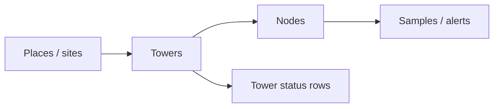

---
tags:
  - slf-ewn
  - dashboard
  - qt
  - qml
  - hub
aliases:
  - Qt Dashboard
parent: "[[SLF-EWN Hub]]"
status: active
---

# Dashboard — Qt 6 / QML

Native desktop console. **SAFE / WARNING / CRITICAL**. Pulls samples from the USB-UART tower on command (or simulation). UI: **Inter + JetBrains Mono**, bundled.

Wire bytes on the tower: [[Firmware Hub#Data formats]]. COM pairs: [[Proteus Hub#End-to-end test]].

The receiver **does not stream unsolicited** when a command is in flight. The app sends one command, waits for a complete `0xAA` reply, then may send the next.

---

## How it uses the data

From each 16-byte dump record: RID u32 BE, then the 12-byte LoRa frame.

| Field | UI |
|:------|:---|
| Device ID u16 | Label **`NODE<n>`** if id **&lt; `0xA000`**, else 4-digit hex. Example `0x0104` → `NODE104` |
| Moisture 0–10000 | Percent = value / 100. Defaults warn **38 %**, critical **58 %** |
| Tilt X/Y/Z i16 | Raw ADXL345 counts: **3.9 mg/LSB**, **1 g ≈ 256 counts**, full-resolution ±2 g ≈ ±512. Angle per axis = `asin(clamp(raw / 256, −1, 1)) × 180/π` (≈ ±90°). Alarm uses **max(\|X\|, \|Y\|, \|Z\|)** vs 8° / 16° |
| Status `0x80` | **Emergency-Interrupt** — CRITICAL even if moisture/tilt are green |
| Record ID u32 | Cursor for INCREMENTAL `'N'`; not wall-clock time |

The node sends **raw counts**, not pre-scaled degrees. The older linear “−1950…1950 → −180…180” mapping is not physically correct and is tracked as **F9** on [[Status and open issues]]. [[Firmware Hub#Data formats]].

Simulation writes the **same 12-byte layout**. SQLite: telemetry, alerts, node profiles, **places**, accounts. Flush ~4 s.

---

## What it does

- Node cards: moisture, tilt, sparklines, status  
- Detail: 24 h / 7 d / 30 d charts, ack, zone label, **optional per-node alarm limits**  
- Alert log: filters, ack / clear, CSV  
- **Map View:** OpenStreetMap or ArcGIS satellite, place polygons, click-to-place nodes  
- Auto site from lat / lon / altitude boxes (**Places** — smallest covering box wins)  
- USB-UART **115200 8N1**, auto-connect, dump commands, Link diagnostics, simulation  
- Admin vs guest (guest **read-only**). PBKDF2-HMAC-SHA256 passwords  

Default `admin`/`admin`, `guest`/`guest`. Continue as guest without a password. Settings → **Access** warns while the default admin password remains. Five failed logins → **30 s** lock.

---

## Build

Qt 6: Core, Gui, Quick, QuickControls2, Qml, **SerialPort**, QuickDialogs2, **Sql**, **Network** (map tiles). C++17. CMake 3.16+ or qmake.

```bash
cmake -S . -B build -DCMAKE_PREFIX_PATH=<Qt6>
cmake --build build --config Release
```

Binary: `SLF-EWN` / `SLF-EWN.exe`.

```bash
qmake SlfEwnDashboard.pro
make          # nmake / mingw32-make on Windows
```

`tools/protocol_smoke.cpp` — 12-byte frames, 16-byte records, STATUS / FULL_DUMP headers, chunked reassembly, CRC reject. Build against `src/core` (Crc8, PacketParser, Types) after wire-format changes.

Tiles need network; cache ~96 MB under Qt cache `…/map-tiles`.

```
src/core/          parse, CRC-8, types
src/model/         serial, SQLite, sim, list models
src/controller/    session, auth, node state
qml/pages/         login, dashboard, alerts, geo map, settings
qml/components/    cards, charts, chrome
qml/fonts/         Inter, JetBrains Mono
tools/protocol_smoke.cpp
```

QML: `App` → `Slf::AppController`, `Auth` → `Slf::AuthController`.

---

## Using the console

1. Sign in.  
2. Auto-open preferred USB-UART (**simulation off**). Other port: serial bar. Sim: Settings → **Link**.  
3. Live receiver: **Refresh** = FULL_DUMP `0x44`. Later Refresh uses INCREMENTAL `0x4E` + last RID when known.  
4. Click a card → detail.  
5. Alert Log: warn / critical / hardware INT; admin CSV.  
6. Map View: pan/zoom OSM or satellite; drop or edit coordinates.  
7. Settings (admin for most tabs):

| Tab | Contents |
|:----|:---------|
| **Thresholds** | Default moisture/tilt warn/crit + live probe preview |
| **Places** | Named sites: two corners lat/lon, optional altitude band |
| **Towers** | Register each tower: id, label, lat/lon, radio/USB identity, notes (Phase 2; single default tower today) |
| **Nodes** | Labels, geo, **home tower** link, per-node alarm overrides |
| **Link** | Port, baud, Refresh / Clear log, RX stats, dump phase, store path, simulation; later: which tower path (USB/LoRa/handheld) |
| **Access** | Users, password, audit |

Hardware `0x80` → Emergency-Interrupt.

**Status colours**

| Colour | Meaning |
|:-------|:--------|
| Green (SAFE) | Below warning thresholds |
| Yellow (WARNING) | Moisture ≥ 38 % or tilt mag ≥ 8° |
| Red (CRITICAL) | Moisture ≥ 58 %, tilt mag ≥ 16°, **or** `0x80` |

---

## Serial (receiver v1.0)

**115200 8N1** host setting, no flow control. DTR + RTS on open.

> **Baud caveat (H9).** `receiver.c` currently produces **111.1 kbaud** at 16 MHz (`uart_init(8)`, `U2X = 0`). The current simulation tolerates it, but the firmware should be corrected before the baud is quoted as compliant.

**Host → receiver**

| Byte | Name | Payload |
|:----:|:-----|:--------|
| `0x53` `'S'` | STATUS | none |
| `0x44` `'D'` | FULL_DUMP | none |
| `0x4E` `'N'` | INCREMENTAL | 4-byte BE last RID |
| `0x43` `'C'` | CLEAR | none (W25Q64 chip erase; next RID 0) |

**Receiver → host:** `0xAA \| cmd \| uint32be length \| payload`

STATUS: 8 B `record_count` + `free_records`. DUMP: `N × 16` records. CLEAR: empty. ERROR `0xFF`: 1 B (`0x01` = unknown command, `0x02` = timeout / bad payload).

Must match [[Firmware Hub#Data formats]] / `receiver.c`.

### Fallback (idle only)

When **no command is in flight**, the same port still accepts:

**ASCII / LoRa lines** (newline):

```
NODE104_DATA:X_12:Y_-3:Z_980:MOIST_42.5%
NODE104_DATA:X_12:Y_-3:Z_980:MOIST_42.5% : EMERGENCY
A104,42.5,1.2,-0.4,0.8
0xB201 3850 120 -40 980 0
```

- `NODE<id>_DATA:X_<raw>:Y_<raw>:Z_<raw>:MOIST_<pct>%` optional `: EMERGENCY`  
- CSV/whitespace: ID, moisture (`≤ 100` → percent else raw), tilt, optional status  
- `#` comments ignored  

**Raw 12-byte frames:** CRC walk, drop one byte on fail.

`receiver.c` does **not** emit those ASCII lines; they are a dashboard parser extra (debug / other firmware).

Link diagnostics: RX bytes, decoded frames, discarded bytes, dump phase, diagnosis string.

---

## Map View

- OSM default; satellite = ArcGIS World Imagery  
- HTTP cache `…/map-tiles` (~96 MB)  
- Places = two-corner boxes + optional altitude; **smallest covering place wins**  
- Nodes without coordinates stay off the map until Map View or Settings → **Nodes**

---

## Store

```
<AppData>/SLF-EWN/SLF-EWN/slfewn.db
Windows: %APPDATA%\SLF-EWN\SLF-EWN\slfewn.db
Linux:   ~/.local/share/SLF-EWN/SLF-EWN/slfewn.db
macOS:   ~/Library/Application Support/SLF-EWN/SLF-EWN/slfewn.db
```

### Registry model (host DB + dashboard)

The host is the place where **towers**, **nodes**, and **how they connect** are registered. Field devices only carry IDs and telemetry; geography and topology live in SQLite + UI.



| Entity | Register / store | Notes |
|:-------|:-----------------|:------|
| **Place** | Name, bounding box, optional altitude | Existing Places tab |
| **Tower** | Tower ID, label, lat/lon, site/place, primary link (USB path / LoRa id), notes | **New** as multi-tower; one implicit tower is enough for the current USB prototype |
| **Node** | Device ID (`0x0104`…), label, lat/lon, **assigned tower_id**, category, threshold overrides | Node air frames do not carry tower id — assignment is host-side |
| **Connection** | Node → home tower; host → tower path (USB / LoRa / via handheld) | Used for routing polls and map grouping |
| **Samples** | Telemetry + alerts keyed by node_id (and tower_id when known) | From tower dump or backhaul |
| **Tower status** | Battery, uptime, flash fill, siren, radios | [[Data path future architecture#Tower self-telemetry (battery, health, life)]] |

**UI expectations**

| View | Behaviour |
|:-----|:----------|
| Settings → **Towers** | Add/edit tower location and identity |
| Settings → **Nodes** | Assign each node to a tower; set map pin |
| Map | Tower markers + node markers; optional line or grouping by home tower |
| Node card | Shows linked tower name/id |
| Tower panel | Health for the selected tower (Phase 2 telemetry) |

**Current prototype:** effectively **one** tower on the active COM port; nodes are registered by Device ID as frames arrive. Schema should still allow `tower_id` so Phase 2 multi-tower and handheld import do not require a redesign.

Full multi-path context: [[Data path future architecture]].

---

## Demo order

- [ ] Login admin + guest  
- [ ] Bar shows COM, not `SIMULATION`  
- [ ] Refresh (`0x44`) → cards  
- [ ] Second Refresh uses `'N'` when RID known  
- [ ] POT-HG / INT → next dump  
- [ ] Map: OSM / satellite, place box, drop node  
- [ ] Places + per-node thresholds persist  
- [ ] Access password banner; simulation toggle  

| Symptom | Fix |
|:--------|:----|
| Bar says `SIMULATION` | Uncheck Link → simulation |
| Bytes ↑, frames = 0 | Wait for `0xAA` + length; check dump phase |
| No new cards | Tower does not push; Refresh / `'N'` |
| Dump empty | Air CRC fail, CLEAR just ran, or no frames logged yet |
| Map blank | Network / tile cache; set node lat/lon |
| Settings gray | Guest session |
| Locked | 30 s after 5 failed logins |
