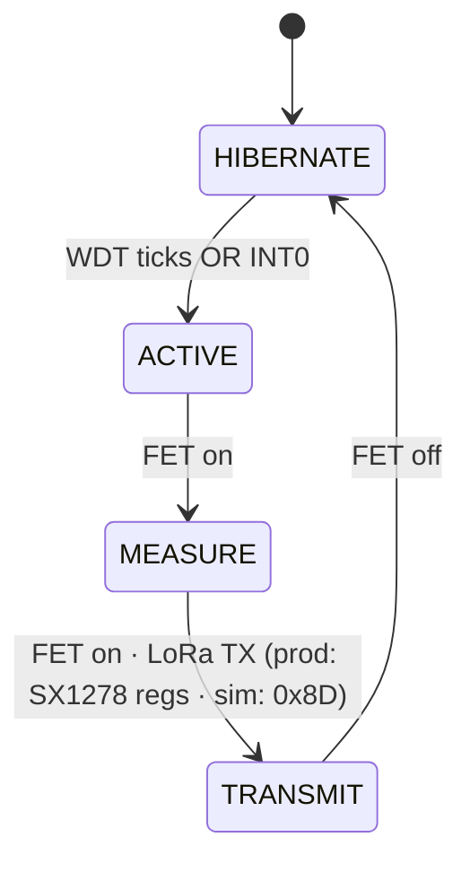

---
tags:
  - slf-ewn
  - firmware
  - avr
  - hub
aliases:
  - Embedded Firmware
  - Protocol
  - Telemetry frame
  - Data formats
parent: "[[SLF-EWN Hub]]"
status: active
---

# Firmware

**C · AVR-GCC · no Arduino.** Source of truth is `Code/` — see [[Code Hub]]. Same `.hex` on the Proteus master as in the DIP-28. The master does not branch on “this is a fake chip”; Proteus fakes speak a **thin SPI contract** (`0x8D` FIFO, 8-bit accel regs). **Production** uses real SX1278 register drivers in `transmitter_lora.c` / `receiver_radio.c` — same **12-byte PDU**, different SPI behind the API.

← [[SLF-EWN Hub]] · [[Code Hub]] · Pins (sim): [[Transmitter Simulation]] · [[Receiver Simulation]] · Host: [[Dashboard Hub]]

---

## Two programs

| | Buried node `transmitter.c` | Surface tower `receiver.c` |
|:--|:----------------------------|:---------------------------|
| `F_CPU` | 8 MHz internal RC | 16 MHz |
| Power | 3.6 V, FET `PD4` | USB 5 V or 5.5–9 V battery header, no FET |
| Job | WDT sleep → measure → LoRa TX | DIO0 ISR → flash log → **poll** UART |
| Debug UART | **9600** 8N1 TX only (`PD1`) | **115200** host setting (111.1 kbaud actual — H9) |



`HIBERNATE`: `SLEEP_MODE_PWR_DOWN`, ADC and SPI disabled, **WDT interrupt** (not reset) and **INT0** still live. INT1 is LoRa TX-done, not a sleep wake.

System-wide hop diagram: [[SLF-EWN Hub#Data flow (as built)]].

---

## Data formats

Three layouts. Do not parse USB as if it were the 12-byte air frame.

### 1. Air / ANT / LoRa payload — 12 bytes, big-endian

Packed in `run_measurement_cycle()`. Same **12 bytes** on production LoRa FIFO, Proteus SPI after `0x8D`, fake ANT UART, and inside flash records.

```
Offset  0        2        4        6        8        10   11
        [ ID u16 ][ moist ][ X i16 ][ Y i16 ][ Z i16 ][st][crc]
```

| Off | Size | Field | Code |
|:---:|:----:|:------|:-----|
| 0 | u16 BE | Device ID | `DEVICE_ID` default **`0x0104`** → bytes `01 04` |
| 2 | u16 BE | Moisture 0–10000 | `(adc10 * 10000) / 1023` on **ADC1** |
| 4 | i16 BE | Tilt X | Raw ADXL345 16-bit count, full-resolution ±2 g (**3.9 mg/LSB**, 1 g ≈ 256 counts) |
| 6 | i16 BE | Tilt Y | same |
| 8 | i16 BE | Tilt Z | same; the host converts each axis to an angle and alarms on the largest magnitude |
| 10 | u8 | Status | [[#Status byte]] |
| 11 | u8 | CRC-8/SMBUS | poly `0x07`, init `0x00`, bytes **0–10** |

Tower **drops** the frame if `crc8(rx,11) != rx[11]`. Fake LoRa TX also checks CRC before ANT.

**`0x8D` — Proteus simulation only.** SPI command used by the **fake** LoRa path so Proteus can accept 12 bytes and raise an interrupt. It is **not** part of the on-air LoRa protocol and **not** used on the production SX1278 register driver (`transmitter_lora.c`).

SPI to fake TX: **`0x8D`** then these 12 bytes, `_delay_us(250)` each (sim build). Fake TX UART: 12 bytes only, `_delay_us(300)` (`fake_lora_transmitter.c`).

### 2. Flash record — 16 bytes

| Off | Size | Field |
|:---:|:----:|:------|
| 0 | u32 BE | Record ID = `record_count` at append (0, 1, 2, …) |
| 4 | 12 B | Air frame (section 1) |

There is **no stored header**. Record *n* starts at `n × 16`. Capacity is **8 MB / 16 B = 524,288 records**. On boot, `record_count` is recovered by finding the first still-erased slot (first byte `0xFF`). Append erases the 4 KB sector when the pointer enters it; when the chip is full, a chip erase restarts the log at record 0. `CLEAR` is also a real chip erase — not a counter reset.

### 3. Tower ↔ dashboard — 115200 8N1, PC polls

Not a stream of 12-byte frames.

> **Baud caveat (H9).** The dashboard opens **115200**, but `receiver.c` calls `uart_init(8)` with `U2X = 0` at 16 MHz, which is **111.1 kbaud** — about **3.6 % low**, outside the usual ~2 % budget. The Proteus link tolerates it. The least-bad 16 MHz divisor is `U2X = 1` / `UBRR = 16` (**117.6 kbaud, +2.1 %**, still marginal); a 14.7456 MHz crystal with `UBRR = 7` gives exactly 115200.

**PC → tower:** one command byte, then optional data.

| Byte | Name | Then | Meaning |
|:----:|:-----|:-----|:--------|
| `0x53` | `'S'` `CMD_STATUS` | — | used + free counts (8-byte payload; **no battery field** — H10) |
| `0x44` | `'D'` `CMD_FULL` | — | dump **all** records |
| `0x4E` | `'N'` `CMD_NEW` | 4-byte BE `last_id` | dump IDs **> last_id** |
| `0x43` | `'C'` `CMD_CLEAR` | — | chip erase; record count returns to 0 |

Unknown → error `0x01`. `'N'` missing 4 bytes (100 ms) → error `0x02`.

**Tower → PC:** 6-byte header, then `length` bytes.

| Off | Size | Field |
|:---:|:----:|:------|
| 0 | u8 | Magic **`0xAA`** (frame sync — if first byte ≠ `0xAA`, discard/resync) |
| 1 | u8 | Echoed cmd (`0x53` / `0x44` / `0x4E` / `0x43` / `0xFF`) |
| 2–5 | u32 BE | Payload length |

| cmd | Payload |
|:----|:--------|
| `0x53` | 8 B: `record_count` u32 BE, `free` u32 BE |
| `0x44` / `0x4E` | `N × 16` records |
| `0x43` | empty |
| `0xFF` | 1 B error |

Example: one stored frame, full dump → header `AA 44 00 00 00 10` then 16 data bytes.

**Node debug** (not USB): 9600 on buried `PD1`, ASCII only, e.g. `[NODE] ID=260 SEQ=3 …` (`0x0104` prints as **260**).

Assert DTR/RTS on the dashboard port.

---

## Status byte

Air frame **offset 10** — “what happened this cycle” flags (room to grow without changing the 12-byte PDU length).

```
bit7     0x80  emergency (INT0 motion wake this cycle)
bits 6–0 seq_counter & 0x7F   (then bit0 may be forced)
bit0     0x01  WHO_AM_I failed — ORed last, so it overwrites seq LSB
```

`seq_counter++` every cycle. Dashboard CRITICAL on **`0x80`**. `0x01` → ignore XYZ (left 0). Fake LoRa RX prints `seq = frame[10] & 0x7F`.

> **Known ambiguity (F10):** `0x01` shares bit 0 with the sequence counter, so an accel-error frame cannot be distinguished from a normal frame whose sequence LSB is 1. Code still sets it because the error path is rare; a future revision should reduce the sequence to six bits (0–63) and use bit 6 for the accel-error flag.

---

## Buried node (`transmitter.c`)

### Pins

| Net | Pin | Code |
|:----|:----|:-----|
| SCK | **PB5** | shared SPI |
| MOSI | **PB3** | shared |
| MISO | **PB4** | shared; slaves high-Z when CS high |
| LoRa NSS | **PB1** | `NSS_LORA_BIT` |
| Accel CS | **PB2** | `CS_ACCEL_BIT` |
| MOSFET gate | **PD4** | LOW = `VCC_SW` on |
| Accel INT1 | **PD2 / INT0** | rising edge, motion detection (`ISC01\|ISC00`) |
| LoRa DIO0 | **PD3 / INT1** | rising = TX done |
| Moisture | **PC1 / ADC1** | 10-bit, `REFS0` = AVCC |
| Debug TX | **PD1** | 9600 |
| RESET | PC6 | 10 kΩ to VCC (hardware) |

SPI master: **Mode 0**, `SPR0` → F_CPU/16. Shared MOSI/MISO/SCK.

### Cycle

1. FET **on**, 5 ms.  
2. Accel `WHO_AM_I` + three 8-bit axis regs.  
3. `adc_read(1)` → moisture.  
4. FET **off**.  
5. Pack 12 bytes + CRC.  
6. FET **on** again, 2 ms (radio is on `VCC_SW`).  
7. LoRa TX: **production** — SX1278 FIFO via `transmitter_lora_*` (registers). **Proteus** — CS low, **`0x8D`**, then 12 payload bytes, wait INT1. Same 12-byte PDU either way.  
8. FET off. Debug UART line.  
9. Sleep until WDT or INT0.

### Watchdog (not 15 min in the sim build)

AVR WDT interrupt **8 s** (`WDP3|WDP0`, `WDIE`).

```
PRODUCTION_INTERVAL_S = 15 * 60
WAKE_INTERVAL_WDT_TICKS = 15*60 / 8   → 112 ticks ≈ 14.9 min
```

**`#define SIM_FAST_WAKE 1` is currently on** — that **replaces** the interval with **1 tick ≈ 8 s**. For burial, **remove / `#undef SIM_FAST_WAKE`**.

**TX stagger implemented** in `transmitter.c`: \(T_i = 15\,\mathrm{min} + (\mathrm{DEVICE\_ID} \bmod 30)\,\mathrm{s}\), quantized to 8 s WDT ticks. Example `0x0104` → +20 s → 115 ticks. **`SIM_FAST_WAKE 1` overrides** to 1 tick for Proteus — must clear for field (F1).

INT0 (motion) breaks the WDT wait immediately; the same cycle runs with `emergency = 1`.

### Moisture

```c
moisture = (raw10 * 10000UL) / 1023UL;  /* 0–10000 */
```

Printed as `moisture / 100` percent. **Linear with ADC.** Capacitive v1.2 / POT-HG in sim is **inverted** (wet → lower volts) — [[Transmitter Simulation#Moisture POT-HG]]. Until firmware inverts or calibrates, a wet pot reads as a **low** % in the packet. Document that mismatch in the report; do not “fix” the wiki independently of the `.c`.

### Accelerometer

ADXL345 on the **always-on 3.6 V rail** (not VCC_SW). Full-resolution ±2 g. SPI **Mode 3**.

**Power modes in `transmitter_accelerometer.c`**

| Mode | When | Registers |
|:-----|:-----|:----------|
| **Low-power wait** | MCU hibernation | `BW_RATE` = LOW_POWER + 12.5 Hz; `POWER_CTL` = MEASURE; ACTIVITY → INT1 |
| **Measure sample** | Start of `run_measurement_cycle` | `BW_RATE` = 100 Hz; MEASURE; then read DATAX0… |

Activity: `THRESH_ACT` default `0x20` (~2 g at 62.5 mg/LSB), `ACT_INACT_CTL` XYZ, `INT_ENABLE` ACTIVITY, map to INT1 → MCU **INT0**. Clear with read of `INT_SOURCE`. Tune threshold on hardware (**F8**).

| Reg | Addr | Meaning |
|:----|:----:|:--------|
| `DEVID` | `0x00` | must be **`0xE5`** |
| `THRESH_ACT` | `0x24` | activity threshold |
| `POWER_CTL` | `0x2D` | MEASURE bit for both modes |
| `INT_ENABLE` / `INT_MAP` | `0x2E` / `0x2F` | ACTIVITY on INT1 |
| `DATAX0`… | `0x32`… | axis data (LSB first) |

Conversion to tilt angle (approx):
```c
/* DATAX0/DATAX1 form int16_t in LSB-first order. */
int16_t raw_x = (DATAX1 << 8) | DATAX0;  /* full-resolution ±2 g, 3.9 mg/LSB */
/* 1 g ≈ 256 counts. Angle per axis: asin(clamp(raw / 256, -1, 1)) * 180/pi */
```
If `DEVID` check fails, tilts stay 0 and status bit0 is set.

> **Host mapping (F9):** the node sends **raw counts**, not pre-scaled degrees. The Qt parser must apply the ADXL345 scale (3.9 mg/LSB, 1 g ≈ 256) and use `asin` per axis. A linear “−1950…1950 → −180…180” mapping is not physically correct and will under-read tilt. Confirm the deployed parser before quoting angles.

---

## Surface tower (`receiver.c`)

Always awake. No FET.

| Net | Pin | DIP-28 |
|:----|:----|:------:|
| SCK / MOSI / MISO | PB5 / PB3 / PB4 | 19 / 17 / 18 |
| `RADIO_CS` | **PB2** | 16 (D8) |
| `FLASH_CS` | **PB1** | 15 (D9) |
| DIO0 | **PD2 / INT0** | 4 |
| UART TX / RX | PD1 / PD0 | 3 / 2 |
| XTAL | PB6 / PB7 | 9 / 10 |

**LoRa SPI:** production `receiver_radio.c` is master **Mode 0** (`CPOL=0`, `CPHA=0`) for the real SX1278. The Proteus fake RX is configured **Mode 1** (`CPHA=1`); that pair is sim-only (F5). Confirm the mode before reusing the fake. UART **UBRR=8, U2X=0** → **111.1 kbaud** at 16 MHz, not 115200 (H9). Matches [[fake_lora_receiver.c]].

**Flash SPI Mode 0:** `0x06` WREN, `0x02` page program + 24-bit address, `0x03` read, `0x05` RDSR bit0 busy, `0x20` 4 KB sector erase, `0xC7` chip erase. `receiver_storage.c` checks the JEDEC ID (`EF 40 17`) before accepting writes. The Proteus 25AA1024 stand-in ignores sector erase and does not supply that ID, so the sim build needs a JEDEC bypass (F4).

### Layout (8 MB W25Q64)

| Address | Use |
|:--------|:----|
| `0x000000` | record 0, 16 B |
| `0x7FFFF0` | record 524,287, 16 B |
| Capacity | `0x800000 / 16` = **524,288 records** |

Append is sequential: erase the sector on entry, page-program one 16-byte record, increment `record_count`. At full capacity the chip is erased and logging restarts at 0. There is no RAM page buffer and no in-place header update.

Main loop: UART commands first, then if `packet_ready` and CRC ok → `receiver_storage_append(frame)`. Wait until DIO0 goes **low** before the next ISR.

---

## Fake chips (Proteus only)

Behaviour: [[Proteus Hub#Fake peripherals]]. Files: [[Code Hub]].

---


---

## RF settings (production)

| Parameter | Design / code target |
|:----------|:---------------------|
| Frequency | **433.0 MHz** ISM |
| Module | Ra-02 (SX1278) |
| Spreading factor | **SF7 baseline** in drivers; SF8–9 allowed if field tests need more margin |
| Bandwidth / coding | **125 kHz**, CR **4/5** class (TX and RX **must match**) |
| PA | **PA_BOOST at +17 dBm configured** (`PA_CONFIG 0x8F`; module capable of +20 dBm) — budget ~120 mA design peak (~87 mA typical at +17 dBm) → TX RC buffer |
| ToA (12 B, SF7 class) | **~40–50 ms** on-air (use this for energy, not a 2 ms edge only) |
| Payload | Fixed **12-byte** PDU + CRC policy |

**ToA** = time the transmitter is actually radiating. Higher SF → longer ToA → more energy and wider collision window.

**Link budget (conceptual):**

$$P_{rx} = P_{tx} + G_{tx} + G_{rx} - L_{soil} - L_{air} - L_{misc}$$

| Term | SLF-EWN order |
|:-----|:--------------|
| \(P_{tx}\) | **+17 dBm configured** (`0x8F`); +20 dBm module maximum |
| \(G_{tx}\) / \(G_{rx}\) | Helix ~0–3 dBi · tower whip ~2–6 dBi |
| \(L_{soil}\) | **10–40 dB** through ~1 m wet clay (**H4** until measured) |
| \(L_{air}\) | Free-space after breakout; design target **100–200 m** class with tower **1.5–2 m AGL** omni |
| \(L_{misc}\) | Connectors, polarisation ~1–3 dB |

Need \(P_{rx}\) above the SF7 modem sensitivity (**~−123 dBm**; better at higher SF). Open-air “many km” figures do **not** apply to the buried metre.

## Pre-flash (off the PCB)

No ICSP on the buried board. ZIF + Arduino as ISP + AVRDUDE.

| Fuse | Value | Meaning |
|:-----|:------|:--------|
| Low | `0xE2` | 8 MHz RC, no CKDIV8 |
| High | `0xDA` | No bootloader |
| Extended | `0xFF` | **BOD disabled** — do not use the Arduino default `0xFD`, which is a 2.7 V brown-out and locks the chip as the Li-SOCl₂ cell ages. `0xFE` selects a 1.8 V BOD if a detector is wanted |

Tower: **16 MHz crystal fuses**, not `0xE2`. The extended fuse is separate from the clock fuses; both are tracked as H2.

---

## Checks

| Test | Pass |
|:-----|:-----|
| Accel `DEVID` | `0xE5` (ADXL345) |
| Node terminal | `[NODE] ID=… TX-OK` |
| Fake LoRa RX | `>>> OK node=.. seq=..` then `>>> delivered` |
| Dashboard | `0xAA` header after `'S'` / `'D'` |
| `'D'` dump | 16-byte records, CRC already checked |
| Sleep (production) | `SIM_FAST_WAKE` off, &lt; 10 µA |

---
