# **INSA 2026 — 5th Round Summer Camp**

## **Group 1** · Embedded Department

**Subterranean Landslide and Flood Early-Warning Network**

#### SLF-EWN — Phase 1 challenges, analysis, and design responses

---

## SLF-EWN

### Phase 1 engineering challenges, quantitative analysis, and design responses

**Subterranean Landslide and Flood Early-Warning Network**

This deck is the **challenges and solutions** record for the prototype (Phase 1): why each hard constraint forced a specific technical response.

Each major section follows **problem → analysis → implementation → status**.


| Item                  | Content                                                                                    |
| :-------------------- | :----------------------------------------------------------------------------------------- |
| Problem domain        | Subsurface moisture and motion before slope failure                                        |
| Hardware              | ATmega328P · ADXL345 · capacitive moisture · Ra-02 (SX1278) 433 MHz · W25Q64 · 1-layer THT |
| Software              | Bare-metal AVR-GCC · Qt 6 / QML host                                                       |
| Method on every topic | **Problem → analysis (equations / limits) → implementation → residual risk**               |

---

## How this deck is organized


**Primary focus:** Phase 1 challenges—the conflicts we faced and the quantitative or architectural solutions in the current node, tower, and host design.

**Secondary:** residual Phase 1 validation risk, then a **short** Phase 2/3 look-ahead.

| Section | Topics |
|:--------|:-------|
| **A** | System architecture, segment parameters, global constraints |
| **B** | Air frame size and protocol (12-byte PDU, host wrappers) |
| **C** | Why not 2.4 GHz · why LoRa CSS · RF configuration |
| **D** | Zones and identity · post-slide tracking · depth · capacitive moisture · thresholds |
| **E** | Energy: cell, duty cycle, P-MOSFET, **47 mF + 1.2 kΩ** RC buffer |
| **F** | Dual wake: WDT period and ADXL345 INT |
| **G** | Soil path loss · antenna length/geometry · PCB EMI |
| **H** | Transmitter PCB size · 1-layer THT · HF placement |
| **I** | Flash (I1–I2) · collisions (I3) · pre-flash (I4) · encryption (I5) · supply-chain trust (I6) |
| **J** | Conclusions |

---

## A1 — System architecture

### What this system is solving

SLF-EWN is a **buried early-warning chain**: nodes at about 1 m sense moisture and motion, send a short LoRa packet, the tower logs it, and the host turns IDs into map places and alarms. Every later challenge (energy, RF, frame size) is constrained by this split of responsibilities.

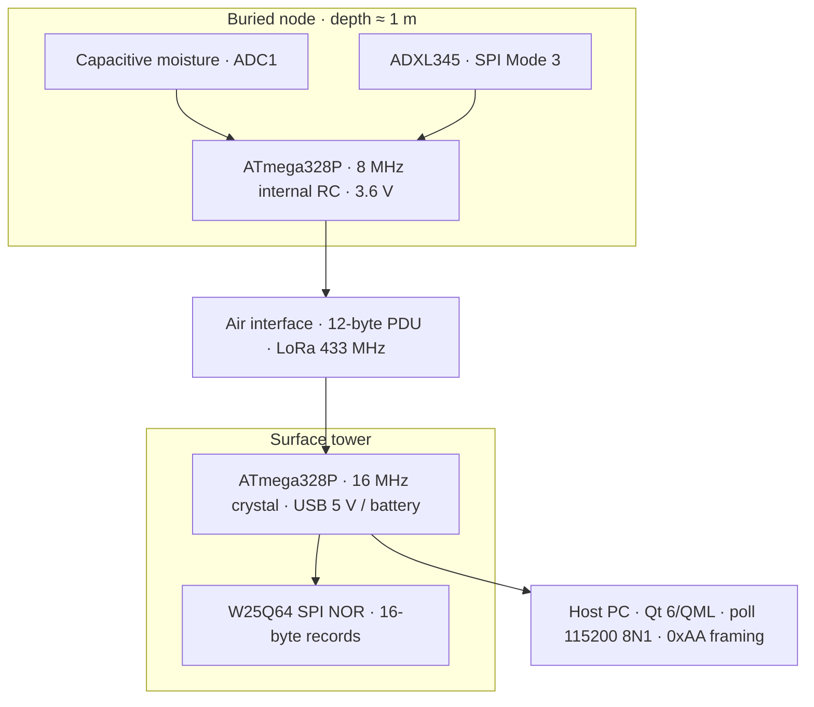

**End-to-end behaviour**

1. Node wakes on timer or motion interrupt, enables sensor/radio rail, samples, packs a **12-byte** frame, transmits, returns to power-down.
2. Tower validates CRC, appends a **16-byte** flash record (record ID + PDU).
3. Host **polls** the tower; it does not rely on an unsolicited 12-byte stream.
4. Host maps **Device ID** to zones, thresholds, and map pins in SQLite.

---

## A2 — Segment parameters

### Four segments, four power and clock stories

The node must last years on a primary cell; the tower may stay powered and listen continuously; the air segment is lossy and shared; the host holds geography and policy. Confusing those roles is how projects grow bloated frames or always-on radios.

| Segment | Clock / power                 | Primary responsibility                      |
| :------ | :---------------------------- | :------------------------------------------ |
| Node    | 8 MHz RC, Li-SOCl₂ 3.6 V      | Sense, pack, TX, µA-class sleep             |
| Air     | 433 MHz LoRa (SX1278 / Ra-02) | Fixed 12-byte payload through soil then air |
| Tower   | 16 MHz, USB or pack → 3.3 V   | Continuous RX path, NOR log, command server |
| Host    | Desktop                       | Places/zones, per-node limits, charts, map  |

**Production vs simulation**

- Same application-level frame layout in field and Proteus.
- Proteus may use fake SPI slaves (`0x8D` FIFO path); field firmware uses real SX1278 registers.

---

## A3 — Global design constraints

### Hard bounds that drove part choices

These are not soft preferences. Burial depth, 1-layer THT, and multi-year life force primary chemistry, short airtime, and socketed pre-flash. Shop stock forced ADXL345 instead of the lower-µA LIS3DH option.

| Constraint     | Quantitative / hard bound         | Design consequence                            |
| :------------- | :-------------------------------- | :-------------------------------------------- |
| Service life   | 3–7 years without opening capsule | Primary cell; average current in low µA       |
| Burial         | ≈ 1 m                             | Soil RF path + subsurface moisture/tilt       |
| PCB process    | **1 copper layer**, 100% THT      | Jumpers only; no 2-layer escape routing       |
| MCU            | ATmega328P, bare-metal C          | Fixed binary protocols                        |
| Air occupancy  | Prefer short time-on-air          | Fixed 12-byte PDU                             |
| Tower autonomy | PC may be disconnected            | SPI NOR logging, not host-side filesystem     |
| Parts          | Local distributor shelf           | ADXL345 adopted; LIS3DH remains future option |

**Assumptions called out later:** soil attenuation coefficients are **literature-scale** until barrel/pit calibration; sleep current is **designed** but must be **measured** on hardware.

---

## B1 — Frame size: problem

### Why payload size is an engineering challenge

Every extra field on the air costs energy, extends collision windows, and weakens the post-soil link margin. Geotechnical wishlist's (voltage, temperature, GNSS, free text) conflict with a sealed µA-class node.

### Observability versus energy, collisions, and soil margin

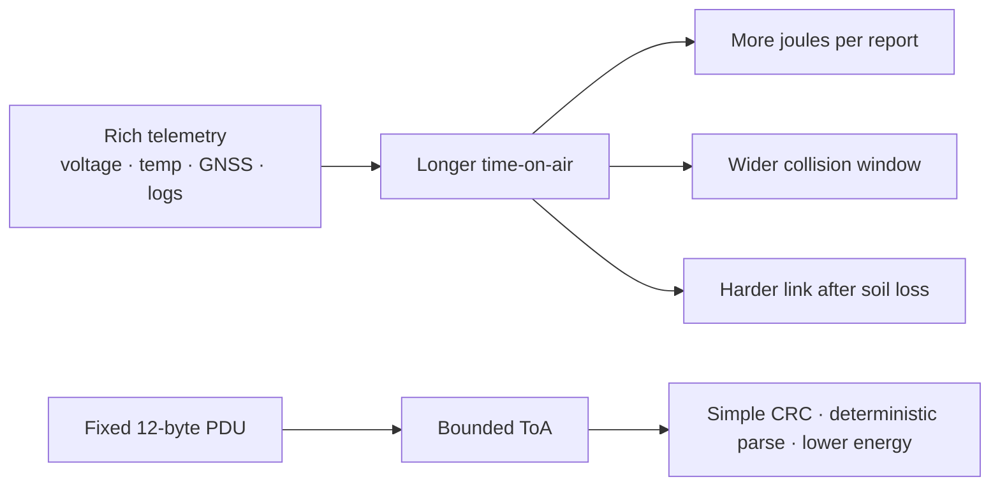

**Problem.** A geotechnical wishlist wants many fields. A buried node on a primary cell, sharing one LoRa demodulator with neighbours, and pushing energy through wet soil, cannot treat payload size as free.

**Design decision.** Freeze a **12-byte** protocol data unit (PDU) with CRC-8. Put GIS, labels, and rich history on the **host**, not in every RF packet.

---

## B2 — Frame size: bit-level layout

### Frozen 12-byte PDU

The solution is a fixed layout: identity, moisture, three-axis tilt, status, CRC. Nothing variable-length on the air. Host software owns labels and history.

```
Offset   0         2         4         6         8        10    11
         [ ID u16 ] [ moist ] [ X i16 ] [ Y i16 ] [ Z i16 ] [st] [crc]
         multi-byte fields are big-endian
```

| Offset | Type   | Semantic         | Notes                                               |
| :----: | :----- | :--------------- | :-------------------------------------------------- |
|  0–1   | u16 BE | Device ID        | Default `0x0104`                                    |
|  2–3   | u16 BE | Moisture 0…10000 | From 10-bit ADC scaled in firmware                  |
|  4–5   | i16 BE | Axis X           | Tilt / acceleration encoding                        |
|  6–7   | i16 BE | Axis Y           |                                                     |
|  8–9   | i16 BE | Axis Z           | Host uses max \|axis\| vs angle thresholds          |
|   10   | u8     | Status           | `0x80` = emergency (INT) wake; seq; accel fault bit |
|   11   | u8     | CRC-8            | Poly-style `0x07`, init `0x00`, over bytes 0–10     |

Tower **discards** frames failing CRC. Same 12 bytes appear inside each 16-byte flash record.

---

## B3 — Frame size: host and storage wrappers

### Where the extra bytes live

Flash and USB add structure around the PDU without enlarging the RF packet. The tower stores 16-byte records; the host uses `0xAA` framed replies so dumps are not a raw 12-byte stream.

| Layer | Size | Contents |
|:------|:-----|:---------|
| Air PDU | **12 B** | ID, moisture, XYZ, status, CRC |
| Flash record | **16 B** | u32 record ID ‖ copy of 12 B PDU |
| USB reply | variable | Magic **`0xAA`** ‖ cmd ‖ u32 length ‖ payload |

**Why wrappers exist**

- Flash needs a monotonic record index for dump/incremental poll (`'D'` / `'N'`).
- USB must support **command/response** (status, full dump, incremental, clear)—not a continuous 12-byte firehose.
- Host can structure polling between commands.

**Open if encryption is added:** ciphertext expansion changes ToA and possibly flash record size; both must be re-budgeted.

---

## C1 — Why not 2.4 GHz for a buried node

### Frequency is a soil-penetration challenge

Compact IoT defaults to 2.4 GHz. Wet soil is a **lossy dielectric**: path loss through wet clay **worsens as frequency rises**, and association-heavy stacks also waste energy.

| Technology | Typical role | Fit for 1 m wet soil + long life? |
|:-----------|:-------------|:----------------------------------|
| Wi-Fi 2.4 GHz | High throughput, AP infrastructure | No — energy, association, soil loss |
| BLE 2.4 GHz | Short-range PAN | No — range and soil path |
| LoRa 2.4 GHz | Some modern modules | Better protocol, still higher soil loss than sub-GHz |
| **LoRa 433 MHz** | Low-rate long-range ISM | **Yes — selected** |

**Literature-scale attenuation (wet clay, sub-GHz):**

$$
\alpha \sim 10\text{–}40\ \mathrm{dB\,m^{-1}}
\quad\Rightarrow\quad
L(d{=}1\,\mathrm{m}) \sim 10\text{–}40\ \mathrm{dB}
$$

**Link-budget sketch** (order of magnitude, ~140 dB at the SF7 setting: **+17 dBm Tx → ≈−123 dBm Rx**; higher SF buys a few dB at the cost of airtime):

1. 1 m wet clay consumes **10–40 dB**.
2. Remaining air budget ≈ **105–135 dB**.
3. That is enough for the **100–200 m** design target with an elevated tower — not a claim of unconstrained open-air kilometres.

> Marketing “many km” figures **do not** apply to the buried metre. **H4** still needs a measured soil path.

---

## C2 — Why LoRa modulation (CSS), not any 433 MHz FSK

### Sub-GHz alone is not enough

433 MHz helps the path; **LoRa CSS** helps the demodulator recover weak signals at low rate. Simple FSK at the same frequency would not buy the same sensitivity class for a 12-byte telemetry burst.

### Sensitivity at low information rate

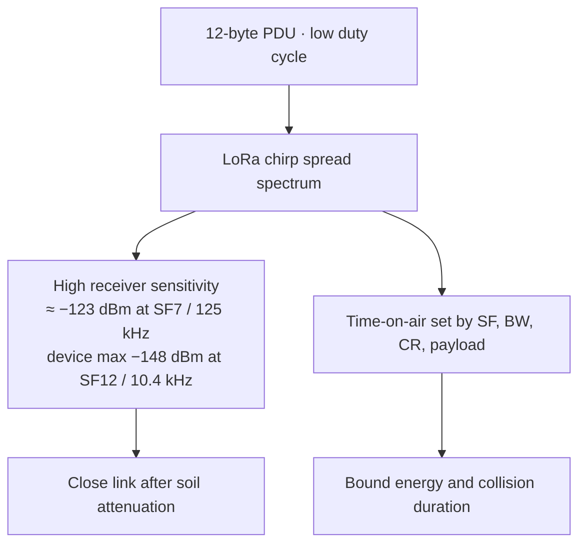

| LoRa property | Use in SLF-EWN |
|:--------------|:---------------|
| High sensitivity | Recovers weak post-soil signals |
| Low bit rate acceptable | Telemetry is small and infrequent |
| Configurable SF/BW | Trade ToA vs robustness (SF7–9 class target) |
| SX1278 ecosystem | SPI control from AVR; Ra-02 module on shelf |

**What we do not need from LoRa:** video, IP mesh, or phone-centric provisioning.

**Implementation:** Ra-02 (SX1278) on 2.54 mm headers; production drivers in `transmitter_lora.c` / `receiver_radio.c`; RF settings must match on both ends (frequency, SF, BW, sync, etc.).

---

## C3 — RF configuration checklist

### Matched parameters on both ends

TX and RX must agree on frequency, spreading, bandwidth, sync, and payload length. Mismatched SF/BW is a silent system failure. ToA and TX power still sit inside the energy budget from section E.

| Parameter             | Design target                                                  |
| :-------------------- | :------------------------------------------------------------- |
| Frequency             | **433.0 MHz** ISM                                              |
| Module                | **Ra-02** (SX1278)                                             |
| Spreading / bandwidth | **SF7**, **125 kHz** in code (SF8–9 are the robustness trade space) |
| TX power              | **+17 dBm configured** (`PA_CONFIG 0x8F`, PA_BOOST)            |
| Payload               | **12 bytes** + CRC policy as implemented                       |
| ToA preference        | **&lt; 500 ms** per packet; **SF7** ≈ **41 ms** pure airtime (~50 ms with sample overhead) |
| Tower antenna         | Vertical polarisation, **1.5–2 m** AGL, omni                   |

**Conceptual link budget**

$$
P_{\mathrm{rx}} = P_{\mathrm{tx}} + G_{\mathrm{tx}} + G_{\mathrm{rx}} - L_{\mathrm{soil}} - L_{\mathrm{air}} - L_{\mathrm{misc}}
$$

**Status:** architecture and drivers exist; **measured path loss on our helix + soil is still open**.

---

## D1 — Zones and identity: problem

### Identity on the wire, geography on the host

The air frame can carry a Device ID; it cannot carry polygons, place names, or per-site threshold tables without breaking the energy and ToA story.

### RF packets cannot carry a full GIS model

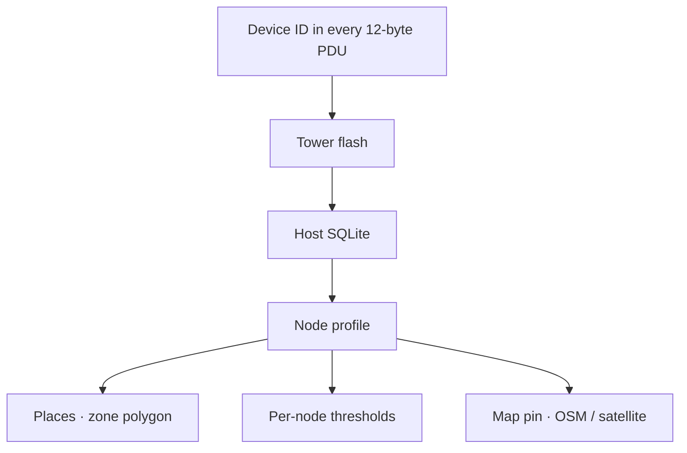

**Problem.** Operators need site name, zone, category (mine wall vs village slope), and map position. Putting all of that on-air would enlarge the PDU and still not replace a real GIS database.

**Split of responsibility**

| Information | Lives where | Why |
|:------------|:------------|:----|
| Who transmitted | **Device ID** on air + flash | Stable primary key, 2 bytes |
| Zone / place name | Host **Places** | Polygons, labels, no ToA cost |
| Category | Host profile / planning | Drives default thresholds |
| Coordinates | Host map (click or lat/lon) | No GNSS in node BOM |

---

## D2 — Tracking after a landslide

### Physical location may move; ID must not

After a slide, the capsule may translate or rotate. The network still needs a stable identity for logging and alerts. Map pins and zone membership are host-side and may need operator update; the node does not run GNSS.

### Geometry can change; identity must not


**Problem.** A real failure may move the capsule. If identity were tied only to map coordinates, time-series continuity would break.

**Stable after the event**

- Device ID in firmware and every PDU
- NOR and SQLite history keyed by ID
- Emergency status when motion INT wakes the node

**Expected to be updated by humans after survey**

- Map pin position
- Zone membership if the node leaves a polygon
- Interpretation of tilt relative to a new rest attitude

**Residual limitation:** no onboard GNSS — displacement is **not** estimated in the node; only motion **detection** + ID-continuous logging.

---

## D3 — Why moisture and tilt at about 1 m depth

### What the node is allowed to observe

Surface-only instruments can miss saturation and motion developing underground. Depth ≈ 1 m is both a useful sensing horizon and the same path the radio must cross. This is early-warning instrumentation, not a full slope FEM.

### Surface instruments often see failure late

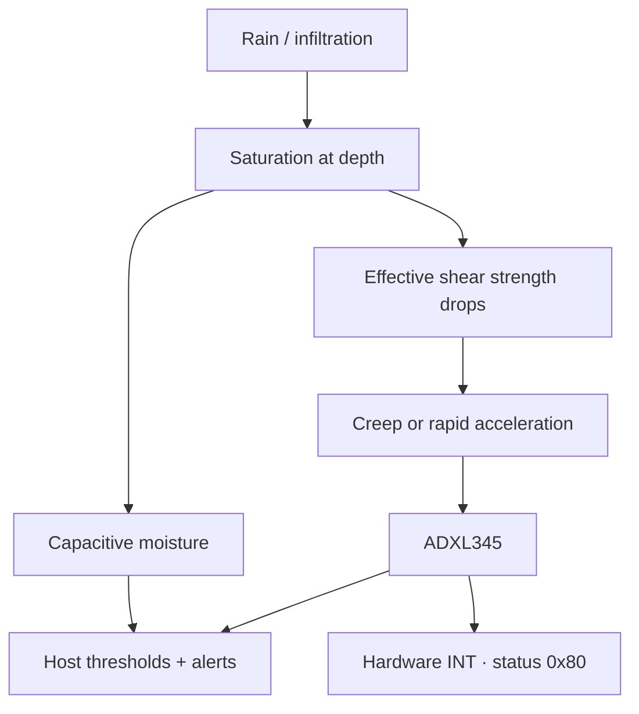

| Observable | Engineering role | Explicit non-role |
|:-----------|:-----------------|:------------------|
| Moisture | Saturation **proxy** | Full hydro-mechanical FEM |
| Tilt / shock | Deformation / impact **indicator** | Survey-grade inclinometer log |
| Depth ≈ 1 m | Design burial + defines soil RF path | Variable-depth instrument string |
| Overburden / weight | **Site category** in planning | On-node load cell |

This build is an **instrumented early-warning prototype**, not a replacement for a full slope-stability study.

---

## D3b — Moisture probe: why not resistive?

### Corrosion is a lifetime challenge

Resistive forks inject current through pore water. In permanent wet soil that becomes electrolysis and electrode damage—unacceptable for a sealed multi-year burial.

### Resistive probes fail in permanent wet soil

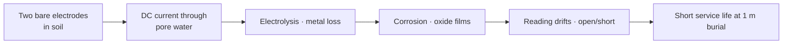

| Issue | What happens with a **resistive** (conductivity) probe |
|:------|:------------------------------------------------------|
| **Galvanic path** | Measurement injects current through the soil between exposed metal |
| **Electrolysis** | Wet soil acts as electrolyte → electrode material dissolves or plates |
| **Corrosion** | Oxide and deposits change resistance → false “dry/wet” |
| **Maintenance** | Probes need cleaning or replacement — conflicts with **3–7 year sealed** goal |
| **Long bias** | If left powered, corrosion accelerates |

**Problem for SLF-EWN.** A sealed node at ≈ 1 m for years cannot accept a sensor that **eats itself** in the same water we are trying to measure.

---

## D3c — Capacitive moisture: design response

### Dielectric sensing plus gated power

Capacitive probes sense wetness through insulation; FET gating removes continuous bias. The host still treats the value as a **proxy** for thresholds, not a metrology certificate.

### Insulated electrodes · dielectric sensing · gated power

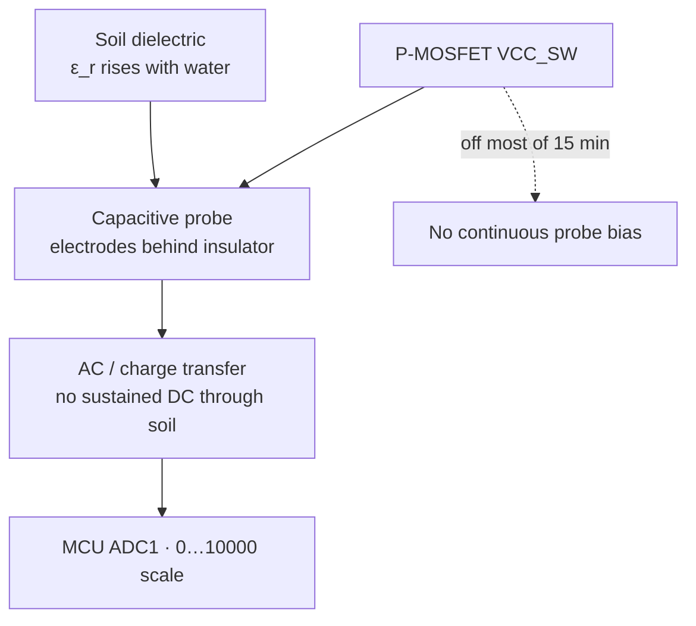

| Decision                           | Why it helps                                                                                 |
| :--------------------------------- | :------------------------------------------------------------------------------------------- |
| **Capacitive (v1.2 class) probe**  | Senses change in **dielectric constant**; metal is not a DC electrode pair in the pore water |
| **Insulated contact with soil**    | Greatly reduces electrolysis vs bare resistive forks                                         |
| **Power only on VCC_SW**           | Probe is biased only for the short measure window — less continuous electrochemical stress   |
| **Sealed capsule + potting path**  | Mechanical isolation of electronics from free water                                          |
| **Host calibration / invert (F3)** | Map ADC to display %; fix polarity for this probe family                                     |

---

## D4 — Threshold hierarchy

### Policy without enlarging the RF frame

Alarm bands are a **host policy** challenge: the node only reports numbers and an emergency bit. Different sites need different warn/critical levels without changing the 12-byte air layout.

### One global limit is wrong for every site


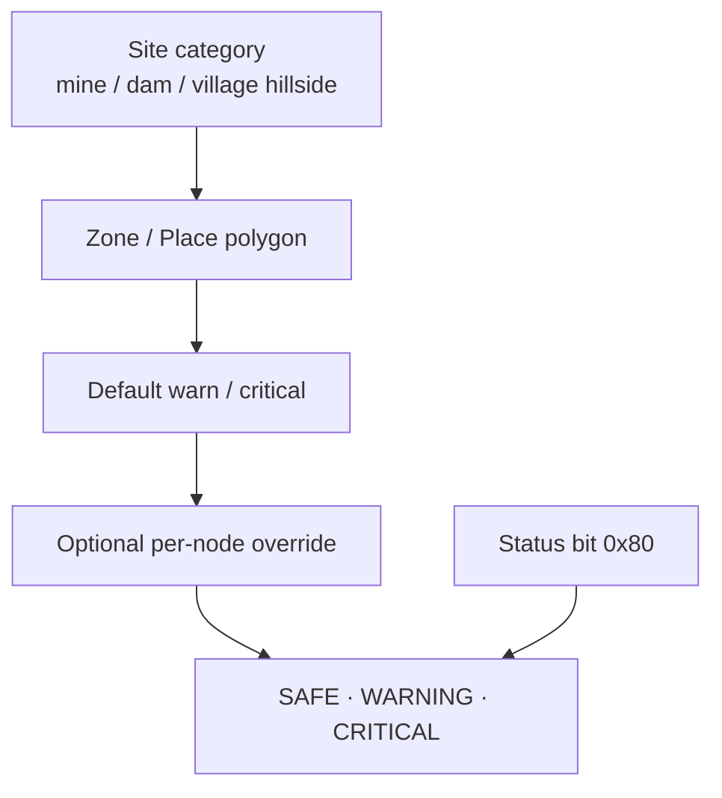

**Host defaults in the current software**

| Quantity                                       | Warning |      Critical       |
| :--------------------------------------------- | :-----: | :-----------------: |
| Moisture (display %)                           | **38**  |       **58**        |
| Tilt magnitude max of absolute axes in degrees | **8°**  |       **16°**       |
| Status `0x80` (motion-INT wake)                |    —    | **Always CRITICAL** |

---

## E1 — Energy: problem statement

### Peak current versus average current

The LoRa PA needs order ~100 mA for milliseconds to tens of milliseconds. The cell that lasts years cannot supply that continuously. Sleep, gating, and buffering are mandatory—not optional optimisations.

### Peak PA current versus multi-year average current

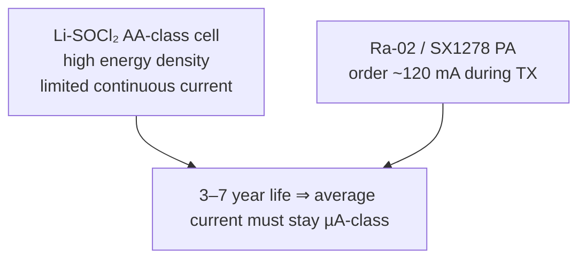

**Problem.** The chemistry that survives years underground cannot source LoRa PA peaks continuously. Leaving the radio or moisture sensor biased between reports would dominate the lifetime budget.

**Architecture response (following slides):** primary cell for energy, supercap for peaks, P-MOSFET to remove load bias, long WDT period, motion wake without powering LoRa until needed.

---

## E2 — Energy: cell capacity and average-current bound

### Order-of-magnitude life math

Stored charge sets a hard ceiling on average current. Design targets sit well below that ceiling so temperature, leakage, and self-discharge still leave margin.

**Stored energy (order of magnitude)**

$$
E \approx 3.6\,\mathrm{V} \times 2.4\,\mathrm{Ah} = \mathbf{8.64\,\mathrm{Wh}}
$$

**Hard upper bound on average current for 7 years** (neglect self-discharge):

$$
I_{\mathrm{avg,max}}
= \frac{2400\,\mathrm{mAh}}{7 \times 365 \times 24\,\mathrm{h}}
\approx \mathbf{39\,\mu\mathrm{A}}
$$

| Parameter | Design value | Rationale |
| :------------------------ | :------------------------- | :-------------------------------------------------- |
| Chemistry                 | Li-SOCl₂                   | Flat voltage, low self-discharge, temperature range |
| Self-discharge            | &lt; 1 %/year typ. @ 20 °C | Calendar life                                       |
| Target $I_{\mathrm{avg}}$ | **&lt; 10 µA**             | Margin for cold, PCB leakage, ageing                |
| BOD fuses                 | Extended `0xFF` (disabled); `0xFE` = 1.8 V | Avoid the 2.7 V (`0xFD`) BOD lock as cell ages |
| Supercap                  | **47 mF / 5.5 V + 1.2 kΩ series** | $\Delta V$≈127 mV; $I_\mathrm{max}$=3.0 mA; $\tau$=56.4 s; 5τ≈4.7 min ≪ 15 min |
| Disconnect                | 2-pin jumper               | Zero drain in storage; no dirt-filled switch       |

---

## E3 — Energy: duty cycle — why sleep dominates
With a ~50–150 ms active window every 15 minutes, the duty cycle is $\sim 10^{-5}$ to $10^{-4}$. Microamps while “asleep” dominate the yearly integral—hence ADXL policy and FET gating.
Time-on-Air (ToA) Profile for a 12-byte payload (433 MHz, 125 kHz BW):

* SF7 Baseline: $\Delta t_{\mathrm{on}} \approx \mathbf{50\,\mathrm{ms}}$ (Includes ~41 ms ToA + sensor sampling overhead)

Duty Cycle Math (Using the SF7 Baseline @ $T = 15\,\mathrm{min} = 900\,\mathrm{s}$):
$$D = \frac{\Delta t_{\mathrm{on}}}{T} = \frac{0.05}{900} \approx \mathbf{5.6 \times 10^{-5}}$$ 
If the active window draws an average of $I_{\mathrm{on}} \approx 100\,\mathrm{mA}$ during transmission:
$$I_{\mathrm{on,avg}} = D \cdot I_{\mathrm{on}} \approx \mathbf{5.6\,\mu\mathrm{A}}$$ 

- Even with a 100 mA TX pulse, the active average stays well under our 10 µA budget.
- This leaves a tight but achievable ~4.4 µA budget for the Hibernate state.

**Interpretation for the review**

- Charge spent while awake is **small** in the yearly integral
- **Hibernate current** (MCU power-down + leakages + any always-on accel mode) decides success
- Therefore every always-on microamp needs a safety justification (e.g. motion INT)

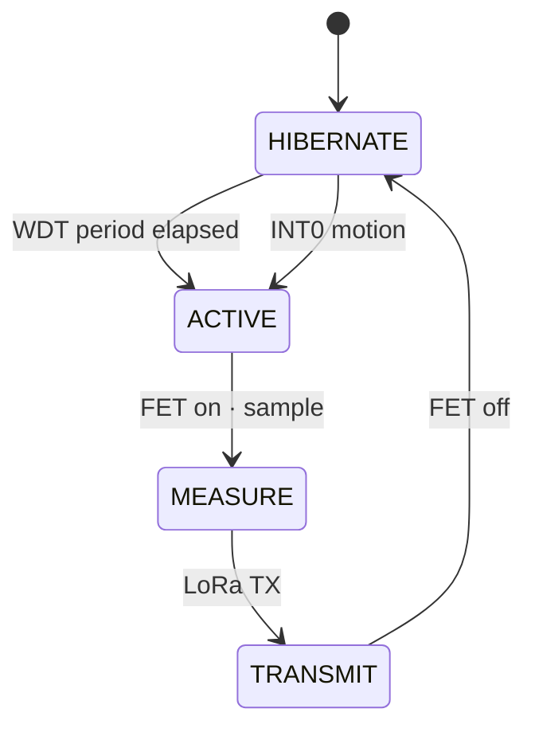

---

## E4 — P-MOSFET load switch (moisture + LoRa)

### Kill quiescent draw of hungry modules

Moisture and Ra-02 must not sit in standby for 15 minutes. A high-side P-MOS (ZVP2106A) switches **VCC_SW** only for measure/TX. ADXL stays on the always-on rail for motion INT.

### High-side power gating

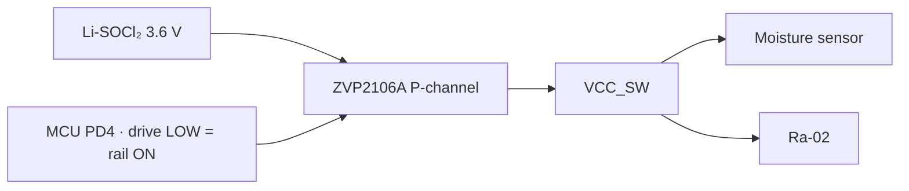

| Mode         | Gate                         | Moisture and LoRa                           |
| :----------- | :--------------------------- | :------------------------------------------ |
| Hibernate    | Held off (pull-up to VCC)    | **Unpowered** — no quiescent module current |
| Measure / TX | Driven on for a short window | Powered only when needed                    |

**Why P-MOS high-side**

- Interrupts the **positive** supply to hungry loads
- Suitable TO-92 leakage is far below leaving modules in standby
- Pull-up keeps the rail off during MCU reset

**Part in BOM:** ZVP2106A (not a random SMD FET that violates the THT / shop constraint).

---

## E5 — Optimized RC Network for the TX Current Pulse
### Buffering the Rail Without Straining the Li-SOCl₂ Cell
The LoRa PA pulse is budgeted at 120 mA for 50 ms (datasheet ~87 mA at +17 dBm; 120 mA at +20 dBm). Bobbin-type Li-SOCl₂ cells cannot deliver this cleanly due to high internal resistance. A tuned **47 mF / 5.5 V** supercapacitor with a **1.2 kΩ series** resistor solves the constraint: topology is **cell → R → always-on rail || C → GND**, so TX current comes from **C** while charge current from the cell is limited by **R**.

**1. The 50 ms Discharge Profile:**

$$\Delta Q = I \Delta t = 0.120\,\mathrm{A} \times 0.050\,\mathrm{s} = \mathbf{0.006\,\mathrm{C}}$$ 
$$\Delta V = \frac{\Delta Q}{C} = \frac{0.006\,\mathrm{C}}{0.047\,\mathrm{F}} \approx \mathbf{0.127\,\mathrm{V}}\ (127\,\mathrm{mV})$$ 

* Result: Ideal \(C\)-only dip ≈ 127 mV → rail ~3.47 V, clear of a 2.7 V BOD. **Real EDLC ESR** adds \(I\cdot R_\mathrm{ESR}\) during the pulse — prefer a low-ESR 47 mF part and verify on the bench.

**2. Cell Protection & Charging Dynamics:**

* Peak battery drain: $I_\text{max} = V_\text{cell}/R = 3.6/1.2\,\mathrm{k}\Omega = \mathbf{3.0\,\mathrm{mA}}$ (worst-case empty-cap inrush) — avoids passivation / cell strain.
* RC time constant: $\tau = R \cdot C = \mathbf{56.4\,\mathrm{s}}$; full recharge $5\tau \approx \mathbf{4.7\,\mathrm{min}} \ll 15\,\mathrm{min}$ wake.

```mermaid
gantt
    title 15-Minute Sleep Cycle Timeline (900s)
    dateFormat  X
    axisFormat %s
    section RC State
    Capacitor Full Recovery (5 Tau) :active, 0, 282
    Quiescent Trickle / Pure Sleep   :crit, 282, 900
```

### Parts

* **Capacitor:** 47 mF / 5.5 V low-leakage EDLC (TX only; self-discharge ideally ≪ 1 µA class).
* **Resistor:** 1.2 kΩ, 1/4 W, 1% metal-film.

---

## F1 — Dual wake: problem

### Timer-only wake is too slow for sudden failure

A pure 15-minute poll can miss rapid acceleration between samples. Continuous high-rate accel would destroy the energy budget. The conflict forces a dual-wake architecture.

### Pure timer sampling misses rapid onset

If the node only wakes every 15 minutes and **all** motion sensing is powered down, a fast failure between samples is invisible until the next WDT wake.

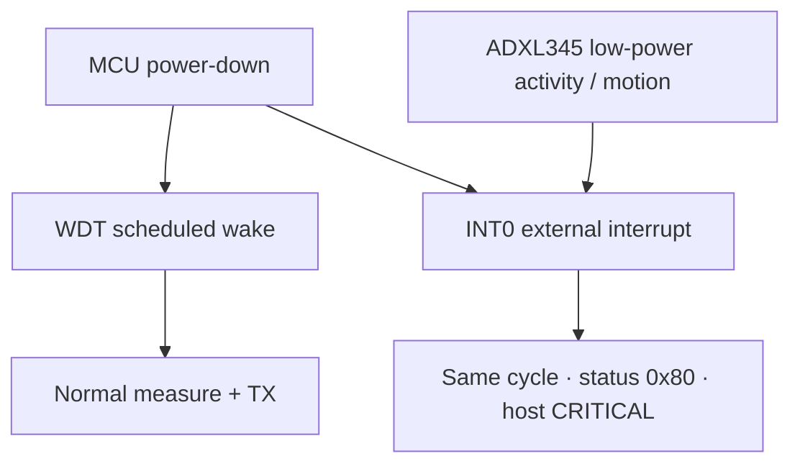

**Problem.** Safety-relevant sudden-slide detection conflicts with switching everything off for µA sleep.

**Resolution principle.** Gate **moisture and LoRa** hard; keep a **motion-capable** accel configuration and MCU INT0 alive; treat INT wakes as emergency in the PDU and UI.

---

## F2 — Dual wake: implementation behavior

### WDT for routine reports; INT0 for emergencies

MCU power-down + 8 s WDT ticks build the 15 min (+ stagger) period. ADXL ACTIVITY → INT1 → MCU INT0 sets emergency status. After TX, accel returns to low-power activity mode.

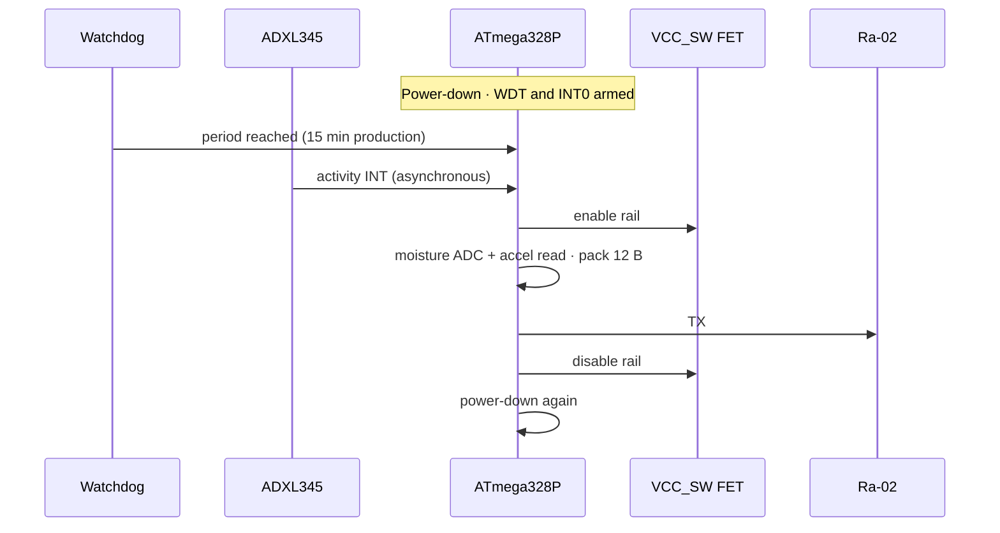

| Wake source | Meaning | Host effect |
|:------------|:--------|:------------|
| WDT | Scheduled telemetry | Normal thresholds |
| INT0 from accel | Sudden movement | Status `0x80` → **CRITICAL** |

**Production interval:** 15 minutes via WDT 8 s ticks (112 ticks ≈ 14.9 min).

---

## G1 — Soil path loss: analysis

### The buried metre is the hard RF segment

Path loss through wet soil can be tens of dB per metre at sub-GHz. Design uses literature-scale α until measurements; frequency choice and short packets are the first mitigations.

$$
L_{\mathrm{soil}} \approx \alpha \cdot d
\quad\text{with}\quad
\alpha \sim 10\text{–}40\ \mathrm{dB\,m^{-1}},\quad
d \approx 1\ \mathrm{m}
$$

so the first metre alone can cost **10–40 dB** before the wave reaches air. After breakout, the problem becomes ordinary surface propagation plus antenna gains.

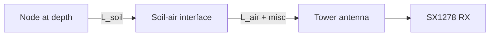

**Design levers (priority for this project)**

1. Sub-GHz carrier (433 MHz)
2. Buried antenna dielectric (air pocket)
3. Polarisation match (vertical–vertical)
4. Tower height 1.5–2 m AGL
5. Short ToA / adequate TX power

**Status:** levers implemented in design; **α for our soil still unmeasured**.

---

## G2 — Antenna: electrical length and clay

### Wavelength and dielectric loading

A quarter-wave at 433 MHz is ~17 cm in air. Wet clay raises effective ε_r and shortens electrical length unpredictably—worst when the slope is wettest.

**Free-space quarter-wave** at 433 MHz, $VF \approx 0.95$:

$$
\frac{\lambda}{4}
= \frac{c}{4f}\cdot VF
= \frac{3\times 10^{8}}{4\times 433\times 10^{6}}\times 0.95
= \mathbf{16.45\ \mathrm{cm}}
$$

**In a dielectric**

$$
\lambda_{\mathrm{med}} = \frac{\lambda_0}{\sqrt{\varepsilon_r}}
$$

| Medium | $\varepsilon_r$ (order) | Effect on a ~16.5 cm wire |
|:-------|:----------------------:|:--------------------------|
| Air cavity | ≈ 1 | Resonance remains usable |
| Wet clay | ≈ 30 | Scale toward **~3 cm**; $\varepsilon_r$ moves with moisture |

**Hard requirement:** the radiating element must live in an **air pocket** for the life of the installation—not packed in clay.

---

## G3 — Antenna: geometry

### Helix in an air pocket

A compact helix on a controlled mandrel fits the capsule better than a straight whip through mud. The critical rule is **air around the radiator**, not soil packing against the element.

| Parameter | Specification |
|:----------|:--------------|
| Type | Helix |
| Wire | Solid copper, cut ≈ **17.0 cm** |
| Mandrel | **5 mm** |
| Turns | ≈ **10–11** close-wound at ~3.2 mm pitch |
| Wound height | ≈ **3.4 cm** (capsule headroom) |
| Environment | Air cavity under top cap |
| Feed | Short board ANT → **SMA-TH** |
| Pigtail | **u.FL / IPEX → SMA** bulkhead (Ra-02 has no SMA) |

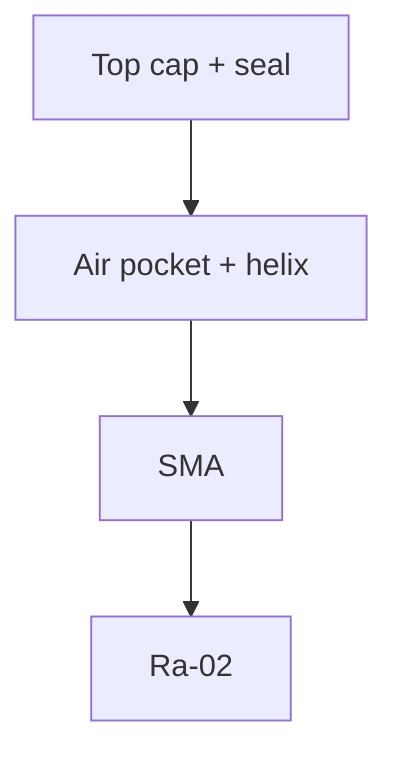

---

## G5 — PCB as an EMI source into the antenna

### The board is part of the antenna problem

SPI edges, PA current, and long ANT traces couple noise into the radiator. Layout rules (short ANT, local decoupling, moisture ADC away from RF, ground pour) are link-budget items, not cosmetics.

### Self-interference on a 50×50 mm one-layer board

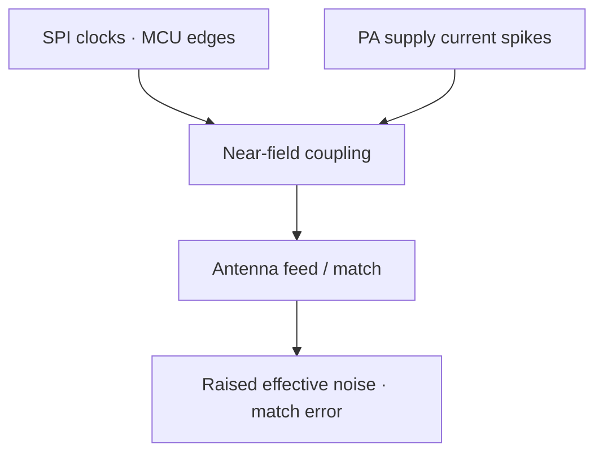

**Problem.** The same small board hosts digital SPI (accel + radio) and a sensitive 433 MHz path. Poor layout spends decibels **before** the wave enters soil.

**Specified mitigations**

| Practice | Purpose |
|:---------|:--------|
| Minimum length ANT → SMA | Loss and loop area |
| 0.1 µF at MCU VCC/AVCC; bulk 10–100 µF at radio VCC | Digital and PA supply integrity |
| Moisture ADC route spatially away from RF/digital | Protect 10-bit samples |
| Ground pour where 1-layer allows | Return path |
| Headered Ra-02 | Controlled placement, field replacement |

---

## H1 — Transmitter PCB size and capsule

### Form factor is a constraint, not a preference

50×50 mm 1-layer THT must slide into a small-ID tube with battery, supercap, and helix air pocket. Every connector and ICSP header competes with that volume.

| Parameter | Value |
|:----------|:------|
| TX PCB | **50 × 50 mm**, 1-layer THT |
| Capsule ID | **50–75 mm** (clear board + SMA) |
| Length | **~100 mm** (PCB 50 mm + 35 mm clearance + 5 mm) |
| Section | **Circular** — load distribution, auger installation |

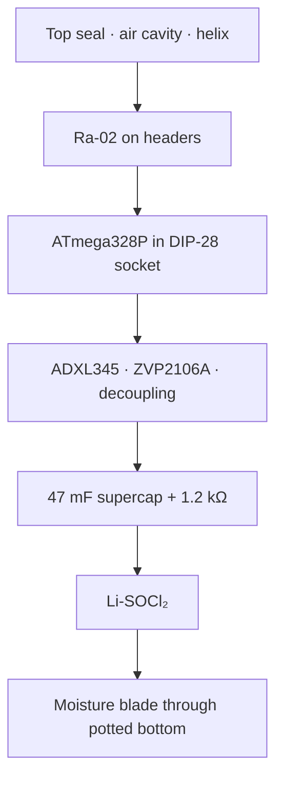

Rectangular boxes concentrate stress at corners under freeze–thaw; the cylinder matches the inline stack.

**Status:** dimensions locked; **SolidWorks deliverables open**.

---

## H2 — Single-layer PCB technology

### Shop and cost forced 1-layer THT

No inner planes, no fine-pitch escape. Crossings use jumpers; modules sit on female headers; MCU is socketed for pre-flash. Two-layer SMD remains a future process change, not this BOM.

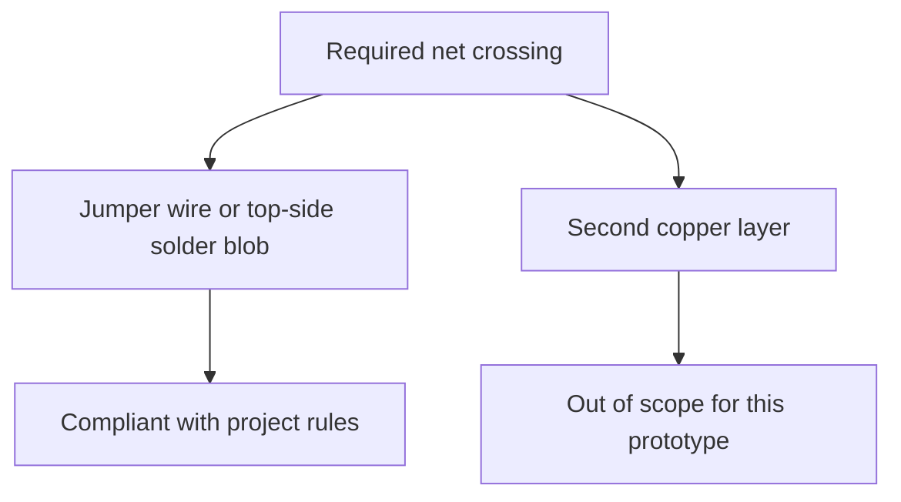

| Rule | Specification |
|:-----|:--------------|
| Layer count | **1** |
| Power traces | **30–40 mil** on high-current paths |
| Signal traces | ≈ **10 mil** |
| Decoupling | 0.1 µF within **5 mm** of VCC and AVCC |
| MCU | DIP-28 **socket** — pre-flash in lab |
| Modules | 2.54 mm female headers preferred |
| RX board | **95 × 70 mm** class |

Driven by cost, student fab process, and field repair—not only RF theory.

**Status:** layout in review; **fab not ordered**.

---

## H3 — Placement for high-frequency and analogue integrity

### Partition digital RF from slow analogue

Keep SPI/radio cluster tight; keep moisture ADC routing quiet; keep power path thick for PA peaks. Placement is the practical EMI control available on one copper layer.

| Cluster | Include | Goal |
|:--------|:--------|:-----|
| **Hot** | MCU SPI, radio SPI, local ceramics, PA bulk | Minimise loop area and supply bounce |
| **Quiet** | Moisture analogue route, probe pads | Reduce digital/RF coupling into ADC |
| **Power** | Cell, supercap, FET, wide traces | Support ~120 mA edges without collapse |

```mermaid
flowchart LR
  subgraph hot["Tight"]
    MCU[MCU]
    RF[Radio]
    DEC[Decoupling]
  end
  subgraph quiet["Separated"]
    ADC[Moisture ADC]
  end
```

---

## I1 — Flash Storage without MicroSD

### Tower Autonomy without a Filesystem
SD/FAT stacks are heavy, power-hungry, and failure-prone for simple append logging on an ATmega328P. A raw **W25Q64** SPI NOR flash chip using fixed 16-byte records eliminates filesystem overhead and safely survives PC disconnects.

**The Flash Architecture Constraint:** 
NOR bits can only be programmed from **1 → 0**. Restoring bits to **1** requires a high-voltage **Erase** operation, executed at a minimum granularity of a **4 KB Sector**.

```mermaid
flowchart LR
  E[Erased State: All 1s] -->|Program Page| P[Programmed State: 0s]
  P -->|4 KB Sector Erase| E
```

| Parameter            | Selected Decision     | Design Rationale                                                                    |
| :------------------- | :-------------------- | :---------------------------------------------------------------------------------- |
| **Device**           | **W25Q64** SPI NOR    | **64 Megabit = 8 Megabyte** total capacity.                                         |
| **Record Structure** | **16 Bytes**          | 4-byte big-endian **record ID** (append counter, not wall-clock time) + 12-byte LoRa PDU. |
| **Storage Policy**   | **Sequential Append** | Write sequentially; track current pointer; execute sector erase at 4 KB boundaries. |

### Storage Capacity Calculation
$$
N_{\max} = \frac{8 \times 10^6 \text{ Bytes (8 MB)}}{16 \text{ Bytes/record}} = \mathbf{524\,288 \text{ records}}
$$

*   **Fleet Autonomy Profile:** At 96 records/node/day for a fleet of **10 buried nodes** (960 records/day total), the raw chip provides **\~546 days (~1.5 years)** of absolute data logging autonomy before roll-over or clearance is required.


---

## I2 — Flash Storage: Wear Mitigation via Sequential Wrap

### Defeating the 100k Erase Cycle Limit without a Filesystem
Standard SPI NOR flash cells degrade after 100,000 erase cycles. Modifying a single "hot" sector repeatedly will quickly destroy the chip. The log writes sequentially and wraps by chip erase, so every sector carries the same share of wear.

### Wear-Leveling Math & Lifespan Projection

* Total Layout: 8 MB total capacity split into 2,048 sectors (4 KB each).
* Sector Density: Each sector holds 256 records (4096 B / 16 B).
* Fleet Drain Rate: 10 nodes generating 960 records/day fills ~3.75 sectors/day.


```mermaid
flowchart LR
  Sector0[Sector 0] --> Sector1[Sector 1] --> SectorDot[...] --> Sector2047[Sector 2047]
  Sector2047 -->|Chip erase when full, restart at 0| Sector0
  classDef active fill:#2c3e50,stroke:#fff,stroke-width:2px,color:#fff;
```


$$\text{Time to fill entire chip } (1 \text{ Full Pass}) = \frac{2048 \text{ sectors}}{3.75 \text{ sectors/day}} \approx \mathbf{546 \text{ days}}$$ 

$$\text{Theoretical erase-cycle life} = 546 \text{ days} \times 100,000 \text{ cycles} \approx \mathbf{1.5\times10^5 \text{ years}}$$

*Retention (20 years typical) and other failure modes, not erase cycles, bound the practical log life.*

### Architectural Decisions

* Sequential Append: Write records end-to-end. Never overwrite data in place.
* Erase-on-Advance: Erase the next 4 KB sector only when the write pointer crosses a sector boundary.
* By advancing linearly through all 2,048 sectors before resetting, local wear is minimized. The hardware easily outlives the 7-year deployment target.

---
## I3 — Multi-node channel contention

### One demodulator, many buried transmitters

Synchronised WDT wakes collide. Stagger $T_i = 15\,\mathrm{min} + (id \bmod 30)\,s$ is implemented; CRC still drops residual overlaps as lost samples, not silent corruption.

One SX1278 demodulates **one** packet at a time. Synchronised WDT wakes produce systematic collisions.

**Temporal stagger (implemented in `transmitter.c`):**

$$
T_i = 15\,\mathrm{min} + (id \bmod 30)\ \mathrm{s}
$$

```mermaid
sequenceDiagram
  participant A as Node A
  participant B as Node B
  participant T as Tower
  A->>T: PDU
  B->>T: overlap
  T-->>T: CRC fail · drop
```

**Today:** stagger spreads wakes by up to 29 s; CRC-8 still drops residual overlaps as **lost samples**.

---

## I4 — Pre-flash manufacturing

### No 5 V ISP on a 3.6 V buried board

DIP-28 socket + lab programming avoids ICSP area and voltage abuse. Field boards receive a pre-flashed MCU; fuse recipes must be written down (tower crystal vs node RC).

**Problem.** In-circuit 5 V ISP on a 3.6 V buried board is a reliability and safety issue; ICSP also consumes scarce 50×50 mm area.

```mermaid
flowchart LR
  LAB[Lab ZIF + ISP + AVRDUDE] --> HEX[Flash image + fuses]
  HEX --> SOCK[Insert into DIP-28 socket]
  SOCK --> FIELD[Buried PCB · no ICSP header]
```

| Topic             | Policy                               |
| :---------------- | :----------------------------------- |
| Node fuses        | L `0xE2`, H `0xDA`, E `0xFF` (BOD off) |
| Field programming | Not supported on the buried assembly |
| Tower             | Separate 16 MHz crystal fuse recipe  |

---

## I5 — Confidentiality of the air interface

### Cleartext ISM is observable

IDs, moisture, tilt, and emergency flags can be received by third parties. Planned path: lightweight encryption with pre-shared keys at pre-flash; re-budget ToA if the frame grows.

**Problem.** Unencrypted PDUs on ISM spectrum are observable with suitable receivers (IDs, moisture, tilt, emergency flags).

```mermaid
flowchart LR
  S[Sense] --> P[Plaintext fields]
  P --> E[Encrypt on node · planned]
  E --> RF[LoRa]
  RF --> D[Decrypt on tower · planned]
  D --> ST[Flash + USB to Qt]
```

| Constraint | Implication |
|:-----------|:------------|
| Short ToA / small PDU | Prefer compact crypto; re-budget if length grows |
| 8 MHz AVR | Lightweight symmetric primitive, not TLS |
| No online CA | **Pre-shared keys** at pre-flash |
| Tower powered / reachable | Single decrypt point; USB stays local |
| Existing seq / status | Candidate **nonce / replay** binding |

**Status:** requirements stated; algorithm + frame + code.

---

## I6 — Firmware supply-chain trust (security)

### Third-party libraries are an integrity risk

Opaque Arduino / vendor packs can change behaviour without review. On a sealed buried node that is a **security risk**, not only a style choice.

**Policy (as built):** drivers and protocol are **self-implemented** in `Code/`; only **AVR-GCC / avr-libc** headers. No Arduino core, no third-party LoRa / ADXL / W25Q / FAT packs.

| In-tree module | Role |
|:---------------|:-----|
| `transmitter_accelerometer.*` | ADXL345 SPI + low-power ACTIVITY |
| `transmitter_lora.*` / `receiver_radio.*` | SX1278 registers |
| `receiver_storage.*` | W25Q64 append / erase |
| `slf_protocol.*` | 12-byte PDU + CRC-8 |

---

## J1 — Conclusions

1. **433 MHz LoRa (SX1278 / Ra-02)** is justified by soil attenuation and sensitivity at low rate—not by generic IoT fashion.
2. **Fixed 12-byte PDUs** bound energy, time-on-air, and collision window; zones, maps, and rich history stay on the host.
3. **Energy architecture** is Li-SOCl₂ + **47 mF / 5.5 V** + **1.2 kΩ** series RC buffer + P-MOS load switch (moisture + LoRa only) + long WDT + ADXL activity in sleep.
4. **RF closure** needs air-pocket helix, polarisation, tower height, and PCB EMI discipline—not only a module datasheet.
5. **Phase 1 residual risk** is **validation and fab** (sleep µA, soil loss, boards)—not an undefined architecture.
6. **Firmware supply-chain:** self-implemented drivers and protocol; toolchain headers only.

---

## End

### SLF-EWN — Phase 1 challenges, analysis, and design responses

**Questions and discussion**
