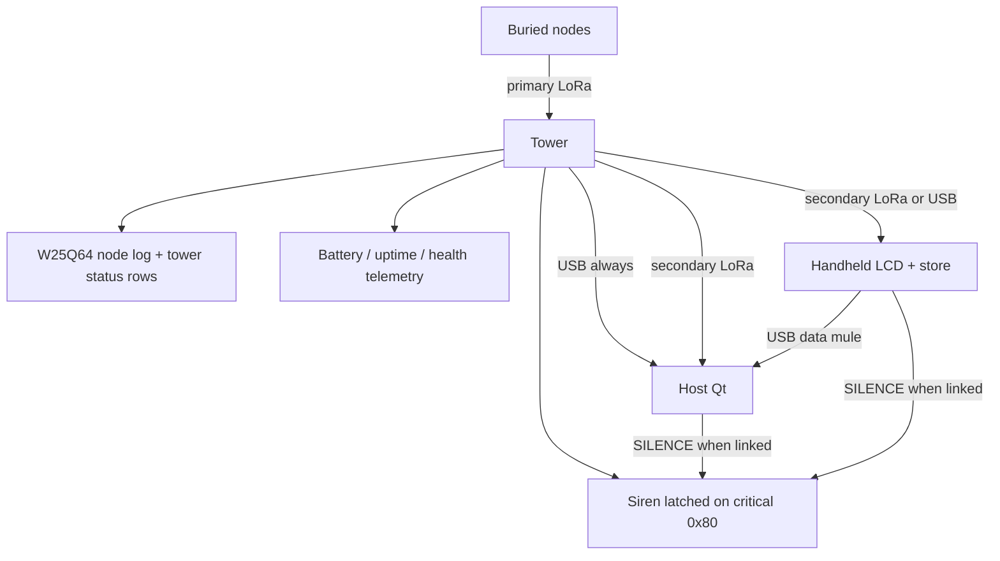

---
tags:
  - slf-ewn
  - architecture
  - future
aliases:
  - LoRa backhaul
  - Handheld collector
  - Multi-path data
parent: "[[Project Overview]]"
status: planned
---

# Data path future architecture (planned — not this prototype build)

← [[Project Overview]] · [[Full Proposal#13. Future work]] · Live build: USB + battery-inlet tower + Qt

**Status:** **Planned.** Current prototype keeps **tower USB ↔ Qt** only. This page freezes the agreed multi-path design so later work does not invent a second story.

**Step-by-step implementation order:** [[Phase 2 and Phase 3 plan]].

---

## Goals

1. Avoid walking to the tower for **routine** status when a radio path exists.  
2. Keep **USB on the tower** for dump, debug, and firmware update.  
3. Add a **simple handheld** for field staff (LCD status, no full map GUI).  
4. Let the **host** use LoRa directly when in range, or ingest data from the handheld over USB when the tower is too far.  
5. **Local tower alarm (siren):** if a critical node message arrives and no supervising host path is active, the tower sounds a loud alarm until a host acknowledges / silences it.

---

## Actors

| Actor | Role |
|:------|:-----|
| **Buried nodes** | Sense + 12-byte LoRa → tower (unchanged) |
| **Tower** | Continuous RX from nodes → W25Q64 log; **USB** retained; **secondary LoRa** for backhaul; **siren**; **battery inlet** (panel/controller Phase 2) |
| **Host PC + Qt** | Advanced map, Places, charts, history; USB and/or LoRa dongle |
| **Handheld** | Portable MCU + mini LCD + LoRa (+ USB device mode); concise status; data mule |

---

## Tower: dual radio + USB

```text
                    ┌─────────────────────────────────────┐
  Nodes (433 MHz) → │ Ra-02 #1  continuous RX → W25Q64    │
                    │ Ra-02 #2  backhaul TX/RX to host or │
                    │           handheld                   │
                    │ USB (FT232)  dump / debug / ISP path │
                    └─────────────────────────────────────┘
```

| Interface | Purpose |
|:----------|:--------|
| **Primary LoRa (existing)** | Listen to buried nodes only |
| **Secondary LoRa (new)** | Talk to host and/or handheld — does **not** share airtime with node RX on the same chip |
| **USB (keep)** | Full dump, debug UART, firmware update, lab bring-up |

**Why secondary module (not time-share one radio):** while the single SX1278 transmits a long backhaul burst, node packets can be missed. A second Ra-02 keeps node RX continuous.

**Backhaul traffic (sensible defaults):**

- Prefer **“records after ID *n*”** (same idea as host command `'N'`), not full chip dump over LoRa.  
- Optional immediate push of **CRITICAL** / status `0x80` frames.  
- Full history remains available on **USB** when needed.

---


---


---

## Tower power: solar + battery backup

### Intent

In the field the tower is **not** assumed to have permanent USB power. USB stays for **lab, dump, debug, and firmware**. Operational power is:

| Source | Role |
|:-------|:-----|
| **Solar panel** | Primary energy while the sun is available |
| **Battery bank** | Backup through night, cloud, and short outages |
| **Charge controller** | Protects battery (charge limits, optional low-voltage disconnect) |
| **USB 5 V** | Optional/override in the lab; not the sole field supply |

```text
  Solar panel ──► charge controller ──► battery ──► 2-pin inlet (5.5–9 V)
                                      │                    │
                                      │                    ├── SS34 ── LM1117 ── 3.3 V ── MCU, radio, flash
                                      │                    └── siren driver (separate rail if needed)
  USB (when plugged) ── SS34 ──► LM1117 IN (bench/service; higher source wins)
```

### Design notes

| Topic | Guidance |
|:------|:---------|
| Continuous RX | Tower radios stay on → average current is **far higher** than the buried node; size panel and battery for **24 h RX + occasional backhaul TX + siren test** |
| Siren | Peak load is short but large; battery must support siren without browning out the MCU |
| Chemistry | **6 V SLA** or **2S LiFePO4 / Li-ion with BMS** (5.5–9 V inlet); a 12 V pack needs a different input stage |
| USB coexistence | When USB is plugged in the lab, prefer not to fight the solar controller — diode-OR or a clear “bench vs field” jumper |
| Autonomy target | State a design goal (e.g. **N days without sun**) when the electrical design is done |

### Relation to current prototype

**This build:** the Rev 1 board carries a **2-pin 5.5–9 V battery inlet** (1 A fuse, SS34 OR into LM1117), so a pack keeps the tower logging without USB. 6 V SLA or 2S LiFePO4 / Li-ion with BMS both fit; the board has **no charger and no LVD**.  
**Field deployment (Phase 2):** add panel, PWM controller, low-voltage cut-off, enclosure integration, and an autonomy test; keep USB for service.

## Tower local alarm (siren)

### Intent

People near the tower must be alerted **even when the PC or handheld is offline**. The tower is the always-on listener; it can drive a **loud siren / buzzer** when a critical message is received from a buried node.

### What counts as critical on the tower

| Source | Tower action |
|:-------|:-------------|
| Air frame **status bit `0x80`** (motion-INT emergency from node) | **Start alarm** after CRC-OK log |
| Optional later: host-downloaded threshold table on tower | Only if we explicitly cache limits on the tower; **not** required for the first siren version |

Moisture/tilt **WARNING/CRITICAL** bands today live in **Qt**. The first siren implementation keys off the **node emergency flag** (`0x80`), which the tower already understands without the PC.

### Host connection and who may silence

```text
Critical frame RX
        │
        ▼
   Start siren (latched ON)
        │
        ├── Host path ACTIVE? ──yes──► Host may send SILENCE / ACK
        │                              (USB command and/or secondary LoRa)
        │                              Siren stops only on explicit silence
        │
        └── Host path NOT active ──► Siren keeps sounding
                                      (optional: local hardware mute button
                                       for maintenance, logged as event)
```

| Condition | Meaning (define in firmware) | Alarm behaviour |
|:----------|:-----------------------------|:----------------|
| **Host path active** | Recent USB poll **or** secondary-LoRa session with host/handheld within a watchdog window (e.g. last successful host command &lt; *T* seconds) | Siren **may** still start on critical, but **host is responsible for SILENCE** |
| **Host path inactive** | No USB activity and no LoRa host/handheld session | Siren **starts and stays ON** until a host path becomes active **and** sends silence, or a local mute is used |
| **Silence command** | New USB/LoRa command (e.g. `'Q'` quiet / silence) from host or handheld acting as supervisor | Clears latched alarm output |
| **New critical while silenced** | Another `0x80` (or policy event) | **Re-arms** siren (does not stay muted forever after one silence) |

**Rule we agreed on:** if the host is connected in a supervising way, **the host stops the alarm**; if not, the tower **keeps alarming**.

### Hardware (tower)

| Part | Role |
|:-----|:-----|
| Siren / high-dB piezo or 12 V siren + driver | Audible alert |
| MCU GPIO → transistor/MOSFET (or dedicated driver) | Switch siren supply |
| Optional local **MUTE** push-button | Maintenance; should be logged if possible |
| Optional LED strobe | Visual duplicate of alarm state |

Power: siren may need a **separate** supply or larger pack than the logic rail — size when the tower leaves permanent USB power.

### Software hooks

| Layer | Work |
|:------|:-----|
| `receiver.c` / radio RX path | On CRC-OK frame with `status & 0x80`, set `alarm_latched = 1` |
| GPIO | Drive siren while latched |
| USB + secondary LoRa command | `SILENCE` clears latch; host UI button “Acknowledge alarm” |
| Host Qt | On critical alert, operator acknowledges → send silence if link up |
| Handheld | Can show ALARM and send silence when used as supervisor |

### Safety language

The siren is a **local attention device**, not a certified life-safety evacuation system (same limit as [[Mentor readiness]]). Humans still decide the response.

## Handheld field device

**Not** a second Qt dashboard. Simple embedded UI.

| Feature | Intent |
|:--------|:-------|
| **Mini LCD** | Concise status: node IDs seen, last moisture/tilt class, SAFE/WARNING/CRITICAL counts, link OK/fail |
| **LoRa** | Connect to tower secondary radio (collect new records / live status) |
| **USB device** | Alternate link to tower if standing next to it; **and** link to host PC to **copy stored samples** into Qt |
| **Local storage** | Enough to hold a field session (flash or FRAM) as a **data mule** |
| **No map / Places GUI** | Host Qt keeps advanced visualisation |

```text
  Tower ──LoRa or USB──► Handheld (LCD + store)
                              │
                              └──USB──► Host PC → Qt dashboard
```

Use cases:

1. Walk the site, poll tower over LoRa, glance at LCD.  
2. If LoRa margin is poor, plug **USB into the tower**, pull data into the handheld.  
3. Back at base, plug handheld **USB into the PC**; Qt imports the session for maps and history.

---

## Host PC

| Path | When |
|:-----|:-----|
| **USB ↔ tower** | Lab, firmware, full dump (today’s path — **always kept**) |
| **LoRa ↔ tower** (host has its own Ra-02 / dongle) | Tower within reliable range (~km-class open air, site-dependent) |
| **USB ↔ handheld** | Tower too far or staff already collected in the field |

Qt remains the **advanced** viewer (map, zones, thresholds, charts). Handheld stays **concise**.

---

## End-to-end path diagram



---


---

## Tower self-telemetry (battery, health, life)

### Intent

The host must show **tower** health next to **node** data: battery state, supply mode, uptime, radio/link health, alarm state, storage fill, and similar. The tower **measures and logs** these values; the host only displays and trends them.

### What the tower should record

| Group | Examples | Why the host needs it |
|:------|:---------|:----------------------|
| **Power** | Battery voltage, approximate SOC %, solar input present/absent, USB powered yes/no, charge state if known | Know if the tower will die overnight |
| **Life / health** | Uptime since boot, reset cause, firmware version/build id | Diagnose brown-outs and stale towers |
| **Radios** | Primary RX OK, secondary LoRa link last-heard, last node RX time, optional RSSI/SNR of last node | See deaf tower vs quiet slope |
| **Storage** | Record count, free slots / % full, last erase event | Avoid silent full flash |
| **Alarm** | Siren latched, muted, last critical node ID + time | Match audible state to UI |
| **Environment (optional)** | Tower box temperature | Battery and radio derating |

Exact sensor set depends on BOM (voltage divider on battery, solar sense pin, etc.).

### How it is stored (alongside node frames)

Node path stays: **16-byte records** = record ID + 12-byte node PDU.

Tower telemetry is a **parallel log**, not stuffed into the 12-byte node air frame:

| Option | Use |
|:-------|:----|
| **A. Status records in flash** | Distinct record type / magic in the 16-byte slot (or slightly longer typed records) so dump streams can interleave node + tower rows |
| **B. Live status registers** | Host polls `STATUS_TOWER` over USB/LoRa for “now” without waiting for a log row |
| **Recommended** | **Both:** periodic status rows in flash (history) + on-demand poll (live UI) |

Example poll payload (conceptual): battery_mV, flags (USB/solar/siren), uptime_s, record_count, last_node_id, fw_id.

### Host Qt

| View | Content |
|:-----|:--------|
| **Tower panel** | Battery bar/voltage, solar/USB badge, uptime, flash fill, siren state |
| **Node views** | Unchanged (moisture, tilt, alerts, map) |
| **Trends** | Tower battery vs time (from logged status rows) |

Handheld LCD can show a **one-line** tower summary (e.g. `BAT 12.1V OK · SIRÉN OFF · LOG 40%`).

### Cadence

| Item | Guidance |
|:-----|:---------|
| Log status to flash | Every few minutes and on events (siren on, USB plug, brown-out warn) — not every second |
| Host poll | Dashboard refresh rate (seconds to tens of seconds) when linked |
| Air backhaul | Prefer compact status on secondary LoRa; full history on USB when needed |

### Prototype vs Phase 2

| Now (USB + battery inlet) | Phase 2 |
|:--------------------------|:--------|
| Record count only; no battery field (H10) | Battery/solar sense hardware + status log + Qt tower panel |
| 2-pin 5.5–9 V inlet fitted; no panel/controller | Panel, PWM controller, low-voltage cut-off, autonomy test |


---

## Host registry: towers, nodes, and connections

### Intent

The **Qt host database and dashboard** are the system of record for:

1. **Where each tower is** (location, label, identity)  
2. **Which nodes exist** and **which tower** they belong to  
3. **How the host is connected** to that tower (USB, LoRa, or via handheld)  
4. **Telemetry** for both nodes and towers  

Buried nodes still only send a **Device ID** + measurements. Tower assignment and map positions are **configured on the host**, not in the 12-byte air frame.

### Entities

| Entity | Key fields |
|:-------|:-----------|
| **Place / site** | Name, polygon or box, optional altitude (existing Places) |
| **Tower** | `tower_id`, label, lat, lon, place_id, USB/LoRa identity, notes |
| **Node** | `device_id`, label, lat, lon, **tower_id** (home tower), category, threshold overrides |
| **Host link** | Active path to a tower: USB port, LoRa session, or import from handheld |
| **Samples** | Time series for nodes (and optional tower_id of the logger) |
| **Tower status** | Battery, uptime, flash, siren, radio health |

### Dashboard behaviour

| UI | Action |
|:---|:-------|
| Settings → Towers | Register/edit tower location and data |
| Settings → Nodes | Register nodes, set coordinates, **bind to a tower** |
| Map | Towers + nodes; filter or group by tower |
| Link / session | Choose which tower path is live |
| Tower panel | Show selected tower’s battery and health |

Detail for the current app structure: [[Dashboard Hub#Registry model (host DB + dashboard)]].

### Prototype vs multi-tower

| Now | Later |
|:----|:------|
| One COM-attached tower (implicit `tower_id = 1`) | Many towers in DB; select active link |
| Nodes appear when frames arrive | Same, plus explicit register + home tower |

## What stays out of *this* prototype BOM

- Second Ra-02 and RF layout on the tower  
- Handheld MCU + LCD + firmware  
- Host LoRa interface and Qt import from handheld  
- Tower **siren + driver + silence command**  
- **Solar panel + charge controller + low-voltage cut-off** sizing for continuous RX and siren (the battery inlet itself is on the Rev 1 board)  
- Tower **self-telemetry** (voltage sense, status log, host/handheld tower panel)  

Current build still validates: nodes → tower RX → flash → **USB → Qt**.

---

## Implementation order (when scheduled)

1. Tower **siren GPIO + latch on status `0x80`** + USB **SILENCE** command (works with today’s single-radio tower).  
2. Secondary LoRa on tower + “new records” air protocol (mirror `'N'`).  
3. Host LoRa RX path into Qt + Acknowledge → silence.  
4. Handheld: LoRa poll + LCD status + local store + silence.  
5. Handheld USB gadget → Qt import.  
6. **Tower field power:** panel, controller, low-voltage cut-off, and autonomy test (inlet already on Rev 1).  
7. Tower **self-telemetry** log + host tower panel (battery, uptime, flash, siren, radios).

---

## Relation to open issues

Does **not** replace H3/H4/F1 (sleep current, soil RF, `SIM_FAST_WAKE`). Those close the **current** prototype first. This architecture is **Phase 2 data access**, not a redesign of the buried node.
