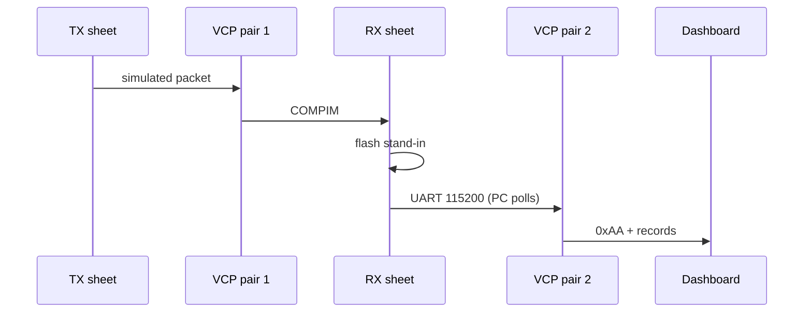

---
tags:
  - slf-ewn
  - proteus
  - hub
  - simulation
aliases:
  - Proteus
  - LoRa Module Simulator
  - Accelerometer Simulator
parent: "[[SLF-EWN Hub]]"
status: active
---

# Proteus

Prove firmware **before** fab. Hex files: [[Code Hub]]. Fake ADXL345 and fake Ra-02 are extra ATmega328P chips. Masters (`transmitter.c`, `receiver.c`) use a **thin SPI contract** (`0x8D` FIFO for Proteus, real SX1278 register writes in production). Same master hex in the DIP-28.

← [[SLF-EWN Hub]] · Wiring: [[Transmitter Simulation]] · [[Receiver Simulation]] · Bytes: [[Firmware Hub#Data formats]]

---

## Two sheets

| Sheet | VCC | Clock | Detail |
|:------|:----|:------|:-------|
| Transmitter | **3.6 V** | 8 MHz RC | [[Transmitter Simulation]] |
| Receiver | **5 V USB** | 16 MHz xtal | [[Receiver Simulation]] |

**Design → Configure Power Rails** first. Wrong VCC → wrong moisture % and fake sleep current.

TX and RX are **separate** `.pdsprj` files. There is no shared ANT net between two running copies of Proteus — use COMPIM instead.

---

## End-to-end test

Two virtual COM **pairs** (e.g. com0com):

| Pair | Side A | Side B |
|:-----|:-------|:-------|
| Packet path | TX COMPIM | RX COMPIM |
| Dashboard | RX UART COMPIM | Qt app @ **115200 8N1** |



1. Install two COM pairs.  
2. Point TX COMPIM and RX COMPIM at pair 1.  
3. Point tower UART COMPIM at pair 2, dashboard at the other end. **Wire DTR and RTS** on the COMPIM or some Qt builds wait forever.  
4. Run both sheets + dashboard. Dashboard must **poll** (`'S'` / `'D'`), not wait for a 12-byte stream.  
5. Move moisture pot → next dump shows moisture. Move accel pots past the activity threshold → emergency wake, status `0x80`.

If the dump is empty while frames arrive on the fake RX, check the F4 flash caveat first: the 25AA1024 stand-in does not answer the W25Q64 JEDEC ID.

Packet path COMPIM is **9600 8N1 raw 12 bytes** (fake LoRa TX UART), not 115200. Dashboard COMPIM is set to **115200**, but the tower firmware actually generates **111.1 kbaud** (H9); if the sim shows framing errors, match the COMPIM to the measured rate.

`transmitter.c` has **`SIM_FAST_WAKE 1`** → ~8 s cycles. Fine for sim; undef for burial.

Multi-node: extra TX sheets with different `DEVICE_ID`. Overlapping ANT bytes → CRC fail on fake RX (`[CRC FAIL]`). **ID jitter is implemented** in `transmitter.c` (`T_i = 15 min + id % 30 s`, quantised to 8 s WDT ticks); `SIM_FAST_WAKE` still collapses that to ~8 s, so sim collisions remain possible.

Pin-level COMPIM: [[Receiver Simulation#COMPIM (serial bridge to Qt dashboard)]].

---

## Fake peripherals

No native Ra-02 / ADXL345 models. Child firmware: [[fake_lora_transmitter.c]], [[fake_lora_receiver.c]], [[fake_accelerometer.c]]. Disable **CKDIV8**. Property `VCC=VCC` on slaves.

> [!warning] Subcircuit bug
> Slave chips: property `VCC=VCC`. Disable CKDIV8. Packet-path COMPIM **9600**; dashboard COMPIM **115200**.

Idle **MISO must float** when CS is high (`DDRB` clear on PB4) — both fakes do this on PCINT2 (PB2).

### Fake LoRa TX (`fake_lora_transmitter.c`)

SPI **Mode 0**, interrupt `SPI_STC`. On NSS falling: drive MISO, `rx_index = 0`. Master sends **`0x8D`** then 12 payload bytes (`_delay_us(250)` on master). On NSS rising: if 13 bytes and `buf[0]==0x8D`, copy 12, **CRC check**, then **UART TX 9600 raw binary** (`_delay_us(300)` per byte) = ANT. Pulse **DIO0 = PD3** 2 ms (master INT1).

Slave NSS is **PB2**, master NSS is **PB1**.

| Function | Master (`transmitter.c`) | Slave |
|:---------|:-------------------------|:------|
| SCK | PB5 | PB5 |
| MOSI | PB3 | PB3 |
| MISO | PB4 | PB4, high-Z when NSS high |
| NSS | **PB1** | **PB2/SS** |
| DIO0 | PD3/INT1 | **PD3** (not PD2) |
| ANT | — | PD1 UART 9600 **binary** |

There is **no** ASCII `[RADIO TX ANT OUT] -> NODE01_DATA:...` in this file.

**Master debug (9600)**

```
=== MASTER NODE BOOT ===
[NODE] ID=260 SEQ=0 X=0 Y=0 Z=0 Moist=48% TX-OK
```

### Fake LoRa RX (`fake_lora_receiver.c`)

UART **9600** RX = ANT (must match TX). Collect **exactly 12 bytes**. CRC ok → debug `>>> OK node=.. seq=..`, preload `SPDR` with `frame[0]`, **DIO0 PD3 HIGH**. The fake is **Mode 1**; production `receiver_radio.c` is **Mode 0** for the real SX1278. The pair has run in the sheet, but confirm the mode if the fake is rebuilt. It clocks 12 bytes, then the slave drops DIO0 and prints `>>> delivered`. CRC fail → `[CRC FAIL]`, no DIO0.

### Fake ADXL345 accelerometer (`fake_accelerometer.c`)

SPI **Mode 3** (matches real ADXL345). `DEVID` `0x00` → **`0xE5`**. Axes are **8-bit ADC pots** (0x80 = 0 g), mapped to simulated acceleration:

| Axis | Child ADC |
|:-----|:----------|
| X | ADC0 / `PC0` |
| Y | ADC1 / `PC1` |
| Z | ADC2 / `PC2` |

10-bit ADC `>> 2` → 8-bit register. Center **`0x80`**. If any axis differs from 0x80 by **> 32 counts**, **INT1 PD2 HIGH** (master INT0 rising). Sampled every ~150 ms + debug UART:

```
=== FAKE ACCELEROMETER READY ===
[ACCEL] X:0x80 Y:0x80 Z:0x80
[ACCEL] X:0xA0 Y:0x80 Z:0x80 MOTION
```

Slave: **Mode 3** SPI (`CPOL=1`, `CPHA=1`), first byte addr `& 0x7F` (read), preload response byte. Second byte is data. CS = PB2/SS, PCINT2 tri-states MISO on CS high.

Master FET **PD4** HIGH must drop `VCC_SW`, which feeds **moisture and Ra-02 only**. The **ADXL345 stays on the always-on 3.6 V rail** so its activity interrupt can wake the MCU. Do not confuse the gate with the moisture ADC pin.

---

## Pass

- [ ] ADXL345 `DEVID` = `0xE5` (not LIS3DH `0x33`)
- [ ] MOSFET kills `VCC_SW` in sleep
- [ ] Fake LoRa RX `>>> delivered`
- [ ] Dashboard `'S'` then `'D'` → `0xAA` records
- [ ] Two TX sheets → `[CRC FAIL]` is OK
