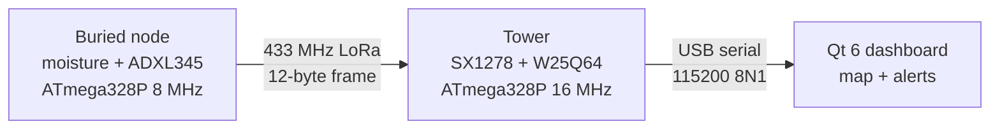

# SLF-EWN

**Subterranean Landslide and Flood Early-Warning Network** — buried moisture and tilt sensing, long-range radio telemetry, and a desktop console for a hillside sensor grid.

INSA 2026 · 5th Round Summer Camp · Group 1 · Embedded Department



## What it is

- **Buried node** — capacitive soil-moisture probe and an ADXL345 accelerometer on an ATmega328P at 8 MHz. It hibernates, wakes every ~15 minutes (staggered per node ID) or on motion, and transmits a 12-byte frame with CRC-8 over a Ra-02 / SX1278 radio at 433 MHz, SF7, BW 125 kHz.
- **Surface tower** — ATmega328P at 16 MHz with an SX1278 receiver and a W25Q64 NOR flash. Every valid frame is appended as a 16-byte record; records survive power loss.
- **Dashboard** — Qt 6 / QML desktop application that polls the tower over USB serial, places nodes on a map, and raises moisture and tilt alerts.

The device layer is written in-tree: AVR-GCC C with full SX1278, ADXL345 and W25Q64 register drivers. No Arduino core, no third-party radio or sensor libraries.

## Video

<a href="https://www.youtube.com/watch?v=RLF6Dt3RYG0">
  
</a>

▶ Click the preview to watch the project walkthrough on YouTube.

## Status

Validated in Proteus simulation; **hardware is not fabricated yet**. Through-soil range, hibernation current, and enclosure sealing are still open. See [Status and open issues](Project/Status%20and%20open%20issues.md). Do not describe the build as field-proven.

## Repository layout

```
Code/          AVR-GCC firmware — real/ production images, sim/ Proteus fakes
Dashboard/     Qt 6 / QML console (Dashboard/Code/ is the application)
Firmware/      air frame and record formats, pin maps, sleep/WDT notes
Proteus/       simulation sheets and fake-chip wiring
EasyEDA/       single-layer THT schematics and PCBs (editable JSON + exports)
SOLIDWORKS/    transmitter enclosure models and dimensioned drawings
Project/       proposal, decision record, challenges, submission checklist
Attachments/   images used by the notes
```

## Documentation

| Document | What it covers |
|:---------|:---------------|
| [Submission Checklist](Project/Submission%20Checklist.md) | Package contents, reading order, pre-submission checks |
| [Full Proposal](Project/Full%20Proposal.md) | Formal technical report (submission draft) |
| [Project Overview](Project/Project%20Overview.md) | Decision record, BOM, radio, team, constraints |
| [Challenges and Solutions](Project/Challenges%20and%20Solutions.md) | Problems, math, fixes, open work |
| [Status and open issues](Project/Status%20and%20open%20issues.md) | Phase status and tracked gaps |
| [Code Hub](Code/real/Code%20Hub.md) | Firmware architecture, module APIs, chip hierarchy |
| [Firmware Hub](Firmware/Firmware%20Hub.md) | 12-byte frame, 16-byte records, status bits, WDT |
| [EasyEDA Hub](EasyEDA/EasyEDA%20Hub.md) | Board decisions, pin maps, layout rules |
| [Mechanical Hub](SOLIDWORKS/Mechanical%20Hub.md) | Enclosure, dimensions, film shot list |
| [Dashboard Hub](Dashboard/Dashboard%20Hub.md) | Qt application and receiver protocol |
| [Proteus Hub](Proteus/Proteus%20Hub.md) | Simulation sheets and fake-chip wiring |

## Building

Firmware is plain AVR-GCC C. Each production image is a small set of `.c` files listed in [Code/README.md](Code/README.md); fuse values, clock settings, and pre-flash checks are in [Firmware Hub](Firmware/Firmware%20Hub.md). The dashboard builds with CMake and Qt 6 — see [Dashboard/Code/README.md](Dashboard/Code/README.md).

## Source of truth

1. `Code/` and the [decision record](Project/Project%20Overview.md#what-we-decided) win when numbers disagree.
2. If a number is not in `Code/` or the decision record, it is not a fact — old drafts and commit history do not count.
3. Change a pin or a byte only in [Firmware Hub](Firmware/Firmware%20Hub.md) and the matching `.c`, then update the simulation or PCB note.
4. Close gaps on [Status and open issues](Project/Status%20and%20open%20issues.md) when code or CAD lands — do not fix prose alone.
