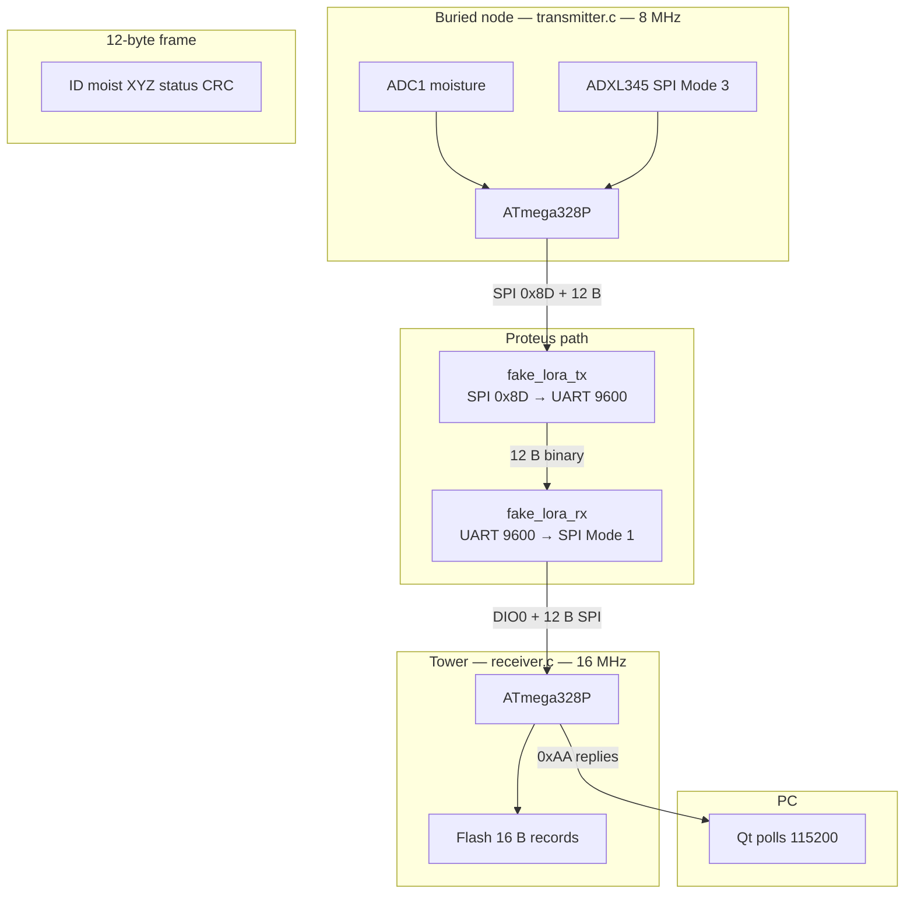

---
tags:
  - slf-ewn
  - hub
  - moc
aliases:
  - Home
  - SLF-EWN
  - Map of Content
cssclasses:
  - wide-page
status: active
---

# SLF-EWN

Buried moisture + tilt → 12-byte LoRa frame → tower flash (16-byte records) → Qt **polls** USB.

This page is the **map**: vault tree, data flow, then links. Pin tables live on the TX/RX notes. Bytes live on [[Firmware Hub]]. Gaps live on [[Status and open issues]]. For the INSA 2026 package, start at [[Submission Checklist]].

---

## Vault hierarchy

```
artifacts/
├── SLF-EWN Hub.md              ← index (this page)
├── README.md
├── Code/                       as-built AVR (wins over older prose)
│   ├── real/                   production sources
│   │   ├── Code Hub.md
│   │   ├── Transmitter/ · Receiver/ · Common/
│   │   ├── ReceiverDevice/ · TransmitterDevice/
│   │   └── realDevicePins.md
│   └── sim/                    Proteus child firmwares
├── Firmware/Firmware Hub.md    formats, pins-in-code, WDT, pre-flash
├── Proteus/                    sim sheets + fake-chip wiring
├── EasyEDA/                    1-layer THT boards
├── Dashboard/Dashboard Hub.md
├── Project/
│   ├── Project Overview.md     decisions, BOM, team, constraints, IEC
│   ├── Full Proposal.md        formal technical report (submission)
│   ├── Challenges and Solutions.md · Challenges Presentation Script.md
│   ├── Submission Checklist.md package index and sign-off
│   ├── Mentor readiness.md     feasibility and standards notes
│   └── Status and open issues.md
├── SOLIDWORKS/
│   └── Mechanical Hub.md       capsule + film (canonical)
└── Blender/Blender Hub.md      → points to Mechanical Hub
```

**Who owns a fact**

| Kind of fact | Canonical note |
|:-------------|:---------------|
| Byte on the air or on USB | [[Firmware Hub]] |
| Which `.c` on which chip | [[Code Hub]] |
| Proteus / DIP nets | [[Transmitter Simulation]] · [[Receiver Simulation]] |
| Copper / BOM photos | [[Transmitter PCB]] · [[Receiver PCB]] |
| Qt UI / map / Places | [[Dashboard Hub]] |
| Decisions / BOM / radio / team | [[Project Overview]] |
| IEC feasibility (review) | [[Project Overview#IEC standards and feasibility]] · [[Full Proposal#8. Standards and feasibility]] |
| Feasibility notes (FAQ) | [[Mentor readiness]] |
| Phase-2 data paths (LoRa backhaul, handheld) | [[Data path future architecture]] |
| Phase 2 / 3 fine-grained plan | [[Phase 2 and Phase 3 plan]] |
| Capsule mm + film shots | [[Mechanical Hub]] |
| Open work / phase | [[Status and open issues]] |

---

## Data flow (as built)



Field hardware: same 12-byte payload on Ra-02; no `0x8D` UART hop.

**Sizes**

| Hop | Baud / bus | Payload |
|:----|:-----------|:--------|
| Node debug `PD1` | **9600** 8N1 TX only | ASCII `[NODE] …` — not the dashboard |
| Node → fake LoRa | SPI Mode **0**, cmd **`0x8D`** | 12-byte frame |
| Fake ANT / COMPIM pair 1 | **9600** 8N1 | same 12 bytes, raw |
| Fake LoRa → tower | SPI Mode **1** | same 12 bytes |
| Flash | SPI Mode **0** | **16 B** = RID u32 + 12 B |
| Tower ↔ Qt / COMPIM pair 2 | **115200** 8N1 host setting (111.1 kbaud actual — H9) | `0xAA` header + payload; PC **polls** |

Format tables: [[Firmware Hub#Data formats]]. End-to-end click path: [[Proteus Hub#End-to-end test]].

---

## Pins at a glance

Full maps: [[Transmitter Simulation]] · [[Receiver Simulation]]. Must match `Code/`.

**Node** (`transmitter.c`)

| MCU | Net |
|:----|:----|
| PB5 / PB3 / PB4 | SCK / MOSI / MISO shared |
| **PB1** | LoRa NSS |
| **PB2** | Accel CS |
| **PD4** | FET gate (LOW = `VCC_SW` on) |
| **PD2 INT0** | Accel INT1, rising |
| **PD3 INT1** | LoRa DIO0 TX-done, rising |
| **PC1 ADC1** | Moisture |
| PD1 | Debug 9600 |

**Tower** (`receiver.c`)

| MCU | Net |
|:----|:----|
| PB5 / PB3 / PB4 | SCK / MOSI / MISO shared |
| **PB2** | Radio CS |
| **PB1** | Flash CS |
| **PD2 INT0** | Radio DIO0 RX-ready, rising |
| PD1 / PD0 | UART 115200 host setting (111.1 kbaud actual — H9) to FTDI |

---

## Open a hub

| Working on | Open |
|:-------------------|:-----|
| Formats, WDT, status bits | [[Firmware Hub]] |
| Source tree / build / APIs | [[Code Hub]] |
| Proteus + fake chips + COM | [[Proteus Hub]] |
| 1-layer boards | [[EasyEDA Hub]] |
| Qt poll / map / Places | [[Dashboard Hub]] |
| Capsule + film | [[Mechanical Hub]] |
| Decisions / BOM / team | [[Project Overview]] |
| Formal write-up | [[Full Proposal]] |
| Submission package / sign-off | [[Submission Checklist]] |
| Challenges / design math | [[Challenges and Solutions]] |
| Phase / open issues | [[Status and open issues]] |

---

## Team

| Team | Owns |
|:-----|:-----|
| **A** | PCB, Proteus, firmware |
| **B** | [[Mechanical Hub\|SolidWorks capsule]] |
| **C** | [[Dashboard Hub\|Dashboard]] |
| **D** | Film (Blender) via [[Mechanical Hub]] |

---

> [!tip] Rule
> Change a pin or a byte only in [[Firmware Hub]] / the `.c` file, then the matching sim or PCB note. Do not paste a second copy of the 12-byte table into other hubs. Track unfinished work on [[Status and open issues]].
